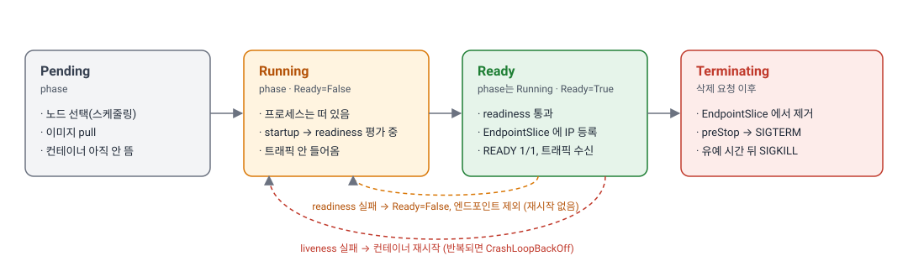
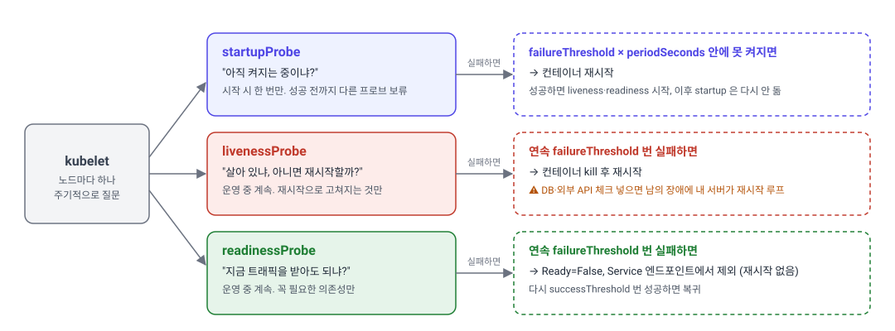
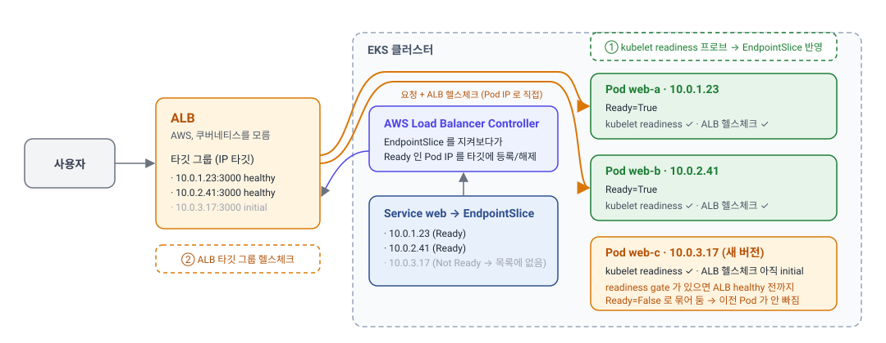
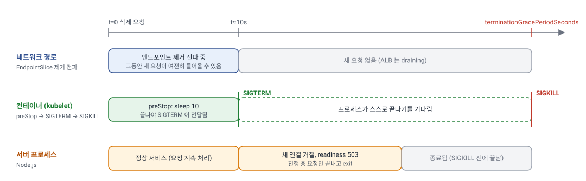

> **TL;DR**
>
> - **프로브**는 노드의 kubelet이 컨테이너에 주기적으로 던지는 질문입니다. **startup**은 "아직 켜지는 중이냐"를 물어 성공할 때까지 다른 프로브를 막고, **liveness**는 "살아 있냐"를 물어 연속 실패하면 재시작하고, **readiness**는 "트래픽을 받아도 되냐"를 물어 실패하면 재시작 없이 EndpointSlice에서만 뺍니다. liveness에 DB나 외부 API 체크를 넣으면 남의 장애에 내 서버가 재시작 루프에 빠집니다.
> - 배포 중 에러 없이 Pod를 교체하려면 **readiness 프로브가 반드시 있어야 합니다.** 없으면 아직 켜지지 않은 새 Pod에 트래픽을 보내면서 이전 Pod를 내립니다.
> - Pod 종료는 SIGTERM → `terminationGracePeriodSeconds`(기본 30초) 대기 → SIGKILL 순서입니다. 배포 중 5xx는 **너무 빨리 닫아서**(SIGTERM을 받자마자 listen을 닫아 아직 들어오는 요청이 거부됨) 또는 **너무 안 닫아서**(SIGTERM을 못 받거나 무시해 SIGKILL로 처리 중 요청이 끊김) 생깁니다. 앞은 `preStop` sleep으로 막고, 뒤는 Node.js를 직접 띄우고 SIGTERM 핸들러를 넣어 막습니다.
> - ALB 같은 외부 로드 밸런서는 readiness 결과를 모르고 **자체 헬스체크**로 따로 판정합니다. 롤링 업데이트는 readiness만 보고 이전 Pod를 내리므로 ALB가 새 Pod를 healthy로 보기 전에 공백이 생깁니다. **Pod readiness gate**를 켜면 둘 다 통과해야 Ready가 되어 이 공백이 사라집니다.

앞 글 [쿠버네티스 구조](/tech/etc/kubernetes/)에서 클러스터가 컨트롤 플레인과 워커 노드로 이루어져 있고, Deployment로 선언한 것을 컨트롤러가 Pod 객체로 만들고 각 노드의 kubelet이 실제로 띄운다는 것까지 살펴봤습니다. 이 글은 그 다음 이야기입니다. kubelet이 띄운 Pod가 트래픽을 받아도 되는지는 누가 어떻게 판단하는지, 새 버전을 배포할 때 이전 Pod는 어떤 순서로 내려가는지, 그리고 배포 직후 잠깐 뜨는 502나 멀쩡한 Pod가 주기적으로 재시작되는 문제가 어디서 오는지를 Next.js 서버를 예로 정리합니다.

아래는 이 글을 읽는 데 도움이 되는 자주 나오는 용어입니다.

- **kubelet**: 노드마다 하나씩 있으며 컨테이너를 띄우고 상태를 보고하는 에이전트.
- **Deployment**: Pod를 몇 개 어떤 모습으로 유지할지 적은 선언.
- **EndpointSlice**: Service가 트래픽을 보낼 Pod IP 목록.

## Pod의 생명주기
Pod가 만들어져 트래픽을 받기까지 다음 단계를 거칩니다.



1. **Pending**: Pod 객체는 만들어졌지만 아직 컨테이너가 돌지 않습니다. 스케줄러가 리소스 여유가 있는 노드를 고르는 중이거나, 노드가 이미지를 내려받는 중입니다. 노드가 부족하면 여기서 멈춥니다.
2. **Running**: 노드에 배치되고 컨테이너가 하나 이상 시작된 상태입니다. **Running은 "서비스 가능"을 뜻하지 않습니다.** 서버가 `listen`을 시작하기 전이라도 프로세스가 떠 있으면 Running입니다.
3. **Ready**: Pod의 컨테이너가 모두 readiness 프로브를 통과한 상태입니다. 이때부터 Service의 EndpointSlice에 IP가 올라가고 트래픽이 들어옵니다. `kubectl get pods`의 `READY` 열에 `1/1`로 표시됩니다.
4. **Terminating**: 삭제가 요청된 상태입니다. EndpointSlice에서 빠지고 컨테이너에 SIGTERM이 전달됩니다. 유예 시간 안에 종료하지 않으면 SIGKILL로 강제 종료됩니다.

위 단계에 나온 값은 모두 **Pod 상태**입니다. Pod 상태는 두 필드로 표현되는데, `phase`는 Pending, Running, Succeeded, Failed, Unknown 다섯 가지뿐이고 Ready는 phase가 아니라 **condition**입니다. `kubectl describe pod`를 치면 둘이 따로 나옵니다. 아래는 컨테이너는 떠 있지만 아직 readiness 프로브를 통과하지 못한 Pod의 출력 일부입니다.

```text
Name:         web-7d4b9c6f8-abcde
Status:       Running                 # phase
Conditions:
  Type              Status
  PodScheduled      True              # 노드가 정해짐
  Initialized       True              # init 컨테이너가 끝남
  ContainersReady   False             # 컨테이너 중 readiness 미통과가 있음
  Ready             False             # 트래픽을 받을 수 없음
```

`Status`는 Running인데 `Ready`는 False입니다. 이 Pod는 `kubectl get pods`에서 `READY 0/1`로 보이고 EndpointSlice에도 없습니다.

컨테이너가 죽으면 kubelet이 같은 Pod 안에서 컨테이너를 다시 시작합니다. 이것을 정하는 값이 Pod 명세의 `restartPolicy`이고, Deployment에서는 컨테이너 목록과 같은 높이에 적습니다. 기본값이 `Always`라서 보통은 적지 않습니다.

```yaml
apiVersion: apps/v1
kind: Deployment
spec:
  template:                   # 이 아래가 Pod 명세
    spec:
      restartPolicy: Always   # 기본값. Deployment 는 Always 만 허용
      containers:
        - name: web
          image: registry.example.com/web:1.2.3
```

시작하자마자 계속 죽으면 재시작 간격이 10초, 20초, 40초로 늘어나 최대 5분까지 벌어지는데, 이 상태가 `CrashLoopBackOff`입니다. 10분 동안 문제없이 돌면 간격은 초기화됩니다.

CrashLoopBackOff는 Pod 상태가 아니라 **컨테이너 상태**입니다. 컨테이너 상태는 Pod 안의 컨테이너마다 따로 기록되고, `kubectl describe pod`에서는 `Containers:` 항목 아래 `State`와 `Last State`로 나옵니다. 컨테이너가 재시작을 반복하는 동안에도 Pod의 phase는 Running이므로 `Status:` 줄은 바뀌지 않습니다.

```text
Status:       Running                 # Pod 상태(phase)는 그대로
Containers:
  web:
    State:          Waiting            # 컨테이너 상태
      Reason:       CrashLoopBackOff   #   다음 재시작을 기다리는 중
    Last State:     Terminated         # 직전 컨테이너가 어떻게 끝났는지
      Reason:       Error
      Exit Code:    1
    Restart Count:  5
```

`kubectl get pods`의 `STATUS` 열은 이와 달리 Pod 상태와 컨테이너 상태를 한 단어로 합친 요약입니다. 기본은 phase를 보여 주지만, 컨테이너에 문제가 있으면 그 사유를 대신 보여 줍니다. 그래서 phase가 Running인 Pod에 CrashLoopBackOff가 찍힙니다. 뒤에 나올 `ImagePullBackOff`도 컨테이너 상태이고 `Terminating`은 삭제 요청 표시인데, 둘 다 같은 이유로 이 열에 나타납니다.

```text
NAME                    READY   STATUS             RESTARTS      AGE
web-7d4b9c6f8-abcde     0/1     CrashLoopBackOff   5 (40s ago)   4m
```

## 프로브
프로브(probe)는 쿠버네티스가 제공하는 **헬스체크 기능**입니다. 라이브러리를 설치하거나 애플리케이션 코드에 쿠버네티스 SDK를 넣는 것이 아니라, Pod 명세(YAML)에 "이 경로로 이렇게 물어봐라"라고 적어 두면 쿠버네티스가 알아서 실행합니다. 역할을 나누면 다음과 같습니다.

| 누가 | 무엇을 |
| --- | --- |
| 개발자 (Pod YAML) | 어떤 방식으로, 어떤 경로에, 몇 초마다 물어볼지 선언 |
| 쿠버네티스 (노드의 kubelet) | 선언대로 주기적으로 요청을 보내고 결과에 따라 재시작·EndpointSlice 제외를 수행 |
| 애플리케이션 | 요청이 오면 200 또는 실패 응답을 돌려주는 엔드포인트만 제공 |

즉 프로브는 **kubelet이 컨테이너에 주기적으로 던지는 질문**입니다. 애플리케이션이 쿠버네티스에 상태를 알려 주는 것이 아니라, 쿠버네티스가 애플리케이션에 물어보는 방향입니다. 프로브는 Pod 단위가 아니라 **컨테이너마다** 선언합니다. 질문하는 방법은 네 가지입니다.

| 방법 | 성공 조건 | 용도 |
| --- | --- | --- |
| `httpGet` | 지정한 경로로 GET 요청을 보내 **200 이상 400 미만** 응답 | HTTP 서버. 가장 일반적 |
| `tcpSocket` | 지정한 포트로 TCP 연결 성공 | HTTP가 아닌 서버, 포트만 열렸는지 확인 |
| `grpc` | gRPC 헬스체크 프로토콜 응답이 SERVING | gRPC 서버 |
| `exec` | 컨테이너 안에서 명령을 실행해 종료 코드 0 | 파일 존재 확인 등. 프로세스 생성 비용이 있어 주기가 짧으면 부담 |

그리고 **무엇을 묻는지**에 따라 세 종류가 있습니다. 같은 `httpGet`을 쓰더라도 질문의 뜻과 실패했을 때의 결과가 다릅니다. 프로브는 기본으로 켜져 있는 것이 아니라 컨테이너 설정에 선언한 것만 kubelet이 실행하고, YAML 필드 이름은 각각 `startupProbe`, `livenessProbe`, `readinessProbe`입니다.



### liveness: 살아 있나
liveness 프로브가 `failureThreshold`번 연속으로 실패하면 kubelet은 컨테이너를 **죽이고 다시 시작**합니다. 교착 상태(deadlock)에 빠졌거나 이벤트 루프가 완전히 멈춰 요청을 받지 못하는 프로세스를 되살리는 것이 목적입니다.

**재시작으로 고쳐지는 문제만 liveness로 감지해야 합니다.** DB 연결이 끊겼거나 외부 API가 죽은 상태를 liveness에 포함하면, 외부 장애가 발생할 때마다 모든 Pod가 동시에 재시작됩니다. 재시작해도 DB는 여전히 죽어 있으니 다시 실패하고, 또 재시작하고, 결국 `CrashLoopBackOff`에 빠집니다. 외부 장애가 복구되어도 Pod는 백오프 간격만큼 늦게 돌아옵니다. liveness는 "프로세스가 요청을 받을 수 있는 상태인가"만 확인하는 가장 단순한 핸들러여야 합니다.

### readiness: 지금 트래픽을 받아도 되나
readiness 프로브가 실패하면 컨테이너를 재시작하지 않습니다. 대신 Pod의 `Ready` condition을 False로 바꾸고 **Service의 EndpointSlice에서 IP를 뺍니다**. 트래픽이 들어오지 않을 뿐, 프로세스는 그대로 돌아갑니다. 다시 성공하면 EndpointSlice에 다시 들어갑니다.

readiness는 시작할 때만 쓰는 것이 아니라 **운영 중에도 계속 평가됩니다**. 캐시 워밍업이 끝나지 않았거나, 처리 중인 요청이 너무 많아 잠시 쉬어야 하거나, 꼭 필요한 의존성이 끊긴 상태라면 readiness를 실패로 돌려 트래픽을 피할 수 있습니다.

다만 여기에도 함정이 있습니다. readiness에 외부 의존성 체크를 넣었을 때 그 의존성이 전체 장애를 일으키면, 모든 Pod가 동시에 Not Ready가 되어 Service의 EndpointSlice에 Pod IP가 하나도 남지 않습니다. 사용자는 "일부 기능이 안 되는 페이지" 대신 **502를** 보게 됩니다. 의존성 없이도 보여 줄 수 있는 페이지가 있다면, readiness에서는 그 의존성을 빼고 애플리케이션 안에서 에러를 처리하는 쪽이 낫습니다. 그 의존성 없이는 아무것도 할 수 없는 경우에만 readiness에 넣습니다.

### startup: 아직 켜지는 중인가
startup 프로브는 컨테이너가 처음 시작될 때만 던지는 질문입니다. startup 프로브가 **한 번 성공하기 전까지는 liveness와 readiness 프로브가 시작되지 않고**, 성공한 뒤로는 다시 실행되지 않습니다. `failureThreshold × periodSeconds` 안에 성공하지 못하면 liveness처럼 컨테이너를 재시작합니다.

startup 프로브가 따로 필요한 이유는 기동 시간 때문입니다. 켜지는 데 60초가 걸리는 서버를 예로 들겠습니다. liveness는 기본값으로 10초마다 묻고 3번 연속 실패하면 재시작하므로, 켜지는 중인 30초쯤에 컨테이너가 재시작됩니다. 다시 켜지다가 또 30초에 재시작되고, 서버는 아무 문제가 없는데도 영원히 기동을 끝내지 못합니다. **멀쩡한 서버가 켜지는 중에 억울하게 재시작되는 루프**입니다.

startup 프로브가 없던 시절에는 이를 막기 위해 liveness의 `initialDelaySeconds`를 길게 두었습니다. "60초 동안은 liveness를 시작하지 마라"는 뜻입니다. 하지만 이 방법에는 두 가지 문제가 있습니다.

- **기동 시간은 매번 다릅니다.** 넉넉히 60초로 잡으면 평소 20초에 켜지는 서버도 60초 동안 아무 감시를 받지 않습니다. 반대로 노드가 바쁜 날 70초가 걸리면 다시 재시작 루프입니다. 한 숫자로 두 상황을 모두 맞출 수 없습니다.
- **기동 때만 필요한 값이 평생 설정에 붙어 있습니다.** `initialDelaySeconds`는 liveness 설정의 일부라서, 뒤에 읽는 사람은 이 60초가 기동 때문인지 다른 이유인지 알기 어렵습니다.

startup 프로브는 이 두 문제를 "최대 이만큼은 기다려 준다"와 "켜진 뒤에는 촘촘하게 본다"로 분리해 풉니다.

```yaml
startupProbe:
  httpGet: { path: /api/health/live, port: 3000 }
  periodSeconds: 5
  failureThreshold: 24      # 최대 5 × 24 = 120초까지 기동을 기다린다
livenessProbe:
  httpGet: { path: /api/health/live, port: 3000 }
  periodSeconds: 10
  failureThreshold: 3       # 켜진 뒤에는 30초 안에 반응 없으면 재시작
```

기동에 20초가 걸리면 20초 만에 startup 프로브가 통과하고 그 즉시 liveness 감시가 시작됩니다. 100초가 걸려도 재시작되지 않습니다. 기동 중에는 느긋하게, 켜진 뒤에는 빡빡하게 볼 수 있다는 점이 `initialDelaySeconds`를 늘리는 것과의 차이입니다.

### 파라미터
세 프로브는 같은 파라미터를 받습니다.

| 파라미터 | 기본값 | 의미 |
| --- | --- | --- |
| `initialDelaySeconds` | 0 | 컨테이너 시작 후 첫 프로브까지 대기 시간 |
| `periodSeconds` | 10 | 프로브 간격 |
| `timeoutSeconds` | 1 | 이 시간 안에 응답이 없으면 실패 |
| `failureThreshold` | 3 | 연속 실패 횟수가 이만큼이면 실패로 확정 |
| `successThreshold` | 1 | 실패 뒤 연속 성공 횟수가 이만큼이면 성공으로 복귀. liveness와 startup은 1만 가능 |

기본값 조합에서 눈여겨볼 것은 `timeoutSeconds: 1`입니다. Node.js 서버가 큰 JSON을 직렬화하거나 SSR 렌더링으로 이벤트 루프가 1초 넘게 막히면 헬스체크 응답도 1초를 넘기고, 이것이 3번 연속이면 liveness가 컨테이너를 재시작합니다. 트래픽이 몰릴 때 멀쩡한 Pod가 재시작되는 원인 중 하나입니다. SSR 서버라면 liveness의 `timeoutSeconds`는 3~5초 정도로 넉넉하게 두는 것이 안전합니다.

`initialDelaySeconds`는 startup 프로브가 있으면 liveness와 readiness에 둘 필요가 거의 없습니다. 두 프로브는 어차피 startup 프로브가 성공한 뒤에 시작되니, 기동이 끝날 때까지 기다리는 역할은 startup 프로브가 맡고 있는 셈입니다. 그래서 이 값은 startup 프로브에 두는 것이 자연스럽습니다. 예를 들어 켜지는 데 최소 10초는 걸리는 서버라면 startup 프로브에 `initialDelaySeconds: 10`을 줘서, 어차피 실패할 처음 몇 번의 프로브를 건너뛸 수 있습니다. 반대로 1~2초면 켜지는 가벼운 서버라면 startup 프로브 없이 liveness에 짧은 `initialDelaySeconds` 하나만 두는 편이 간단합니다.

readiness의 `successThreshold`를 2~3으로 두면 한 번 성공했다고 바로 트래픽을 받지 않고 안정적으로 응답하는지 확인한 뒤 들어가므로 깜빡이는(flapping) 상태를 줄여 줍니다.

### 선언 예시
세 프로브를 Deployment의 컨테이너에 붙이면 다음과 같습니다. 경로는 뒤에서 만들 헬스체크 엔드포인트입니다.

```yaml
containers:
  - name: web
    image: registry.example.com/web:1.2.3
    ports:
      - containerPort: 3000
    startupProbe:
      httpGet: { path: /api/health/live, port: 3000 }
      periodSeconds: 2
      failureThreshold: 30      # 최대 60초까지 기동을 기다린다
    livenessProbe:
      httpGet: { path: /api/health/live, port: 3000 }
      periodSeconds: 10
      timeoutSeconds: 3
      failureThreshold: 3       # 30초 동안 응답 없으면 재시작
    readinessProbe:
      httpGet: { path: /api/health/ready, port: 3000 }
      periodSeconds: 5
      timeoutSeconds: 3
      failureThreshold: 2       # 10초 안에 EndpointSlice에서 제외
      successThreshold: 2       # 10초 연속 성공해야 다시 포함
```

startup은 짧은 간격으로 자주 물어서 기동이 끝나는 즉시 넘어가게 하고, liveness는 느긋하게, readiness는 트래픽에 바로 영향을 주므로 liveness보다 빠르게 반응하도록 둡니다. 숫자는 서버의 기동 시간과 트래픽 특성에 맞춰 조정하면 됩니다.

### 헬스체크 엔드포인트
프로브는 쿠버네티스가 실행하므로 애플리케이션이 할 일은 **응답할 엔드포인트를 만드는 것**뿐입니다. 다만 세 프로브는 묻는 것이 다르기 때문에 엔드포인트도 나누는 것이 좋습니다. 하나로 합치면 앞에서 본 "liveness에 외부 의존성이 들어가는" 문제를 피하기 어렵습니다. 예제는 Next.js App Router의 Route Handler입니다.

```ts
// app/api/health/live/route.ts
// 프로세스가 요청을 받을 수 있는가. 의존성을 보지 않는다.
export const dynamic = 'force-dynamic';

export function GET() {
  return Response.json({ status: 'ok' });
}
```

```ts
// app/api/health/ready/route.ts
// 트래픽을 받아도 되는가. 꼭 필요한 의존성만 확인한다.
export const dynamic = 'force-dynamic';

export async function GET() {
  // 예: 이 서버가 그 없이는 아무것도 못 하는 의존성만
  // await checkRequiredDependency();
  return Response.json({ status: 'ok' });
}
```

> **`force-dynamic`이 필요한 이유**
>
> App Router의 `page.tsx`, `layout.tsx`, `route.ts`는 파일 최상위에서 정해진 이름의 상수를 export해 그 라우트의 동작을 바꿀 수 있습니다. 이것을 라우트 세그먼트 설정이라고 부르고, `dynamic`은 그중 "이 라우트를 빌드 때 미리 만들어 둘지, 요청마다 실행할지"를 정하는 값입니다. 함수 호출이 아니라 상수 export인 이유는 Next.js가 빌드 때 코드를 실행하지 않고 값을 읽어야 하기 때문이고, 그래서 값은 리터럴이어야 합니다.
>
> 기본값은 `'auto'`이고, 이때는 Next.js가 핸들러 코드를 보고 둘 중 하나로 정합니다. 기준은 요청이 와야만 알 수 있는 값을 읽느냐입니다. `request.headers`, 쿼리스트링, `cookies()`, `headers()` 중 하나라도 읽으면 동적 라우트가 되어 요청마다 실행되고, 아무것도 읽지 않으면 정적 라우트가 됩니다. 정적 라우트는 빌드 때 딱 한 번 실행되고, 그 결과가 저장됩니다. 운영 중에는 핸들러 코드가 다시 돌지 않고 저장된 응답이 그대로 나갑니다. 어느 쪽으로 분류됐는지는 `next build` 마지막에 출력되는 라우트 표에서 `○ (Static)`, `ƒ (Dynamic)` 기호로 확인할 수 있습니다.
>
> 위 헬스체크 핸들러는 요청에서 아무것도 읽지 않습니다. 그래서 Next.js 14까지는 정적 라우트로 분류되고, `/api/health/ready`는 빌드 때 저장된 `{"status":"ok"}`를 200으로 계속 돌려줍니다. 핸들러 안에 DB 확인 코드를 넣어도 그 코드는 빌드 때 한 번만 실행되므로, 운영 중 DB가 죽어도 200이 나갑니다. 프로브가 있어도 없는 것과 같아지는 것입니다. `'force-dynamic'`은 이 자동 분류를 끄고 요청마다 코드를 실행하게 합니다.
>
> Next.js 15부터는 GET Route Handler를 기본으로 캐시하지 않아 이 문제가 없습니다. 그래도 붙여 두면 버전과 상관없이 "요청마다 실행"이라는 의도가 코드에 남으므로 해롭지 않습니다.

프로브는 기본값으로도 Pod 하나당 10초마다 두 번씩 요청을 보냅니다. 복제본이 10개면 분당 120줄의 헬스체크 로그가 쌓입니다. 미들웨어나 로거 설정에서 `/api/health` 경로는 접근 로그를 남기지 않도록 걸러 두는 것이 좋습니다. 디버깅 때 진짜 요청을 찾기 어려워지는 것은 물론, 로그 수집 비용도 무시할 수 없습니다.

## 외부 로드 밸런서와 두 번의 헬스체크
앞 글의 [애드온](/tech/etc/kubernetes/#애드온) 절에서 본 것처럼, 클러스터 밖에서 들어오는 트래픽은 Ingress 선언을 보고 AWS Load Balancer Controller가 만든 ALB가 받아 Pod IP로 직접 보냅니다. 이 절은 그 구성을 예로 들지만, 클라우드 로드 밸런서를 쓰는 구성이라면 어디서나 같은 문제가 생깁니다.



여기서 Pod는 트래픽을 받을 자격을 **두 곳에서 따로 심사**받습니다. 로드 밸런서가 쿠버네티스 바깥에 있는 별도 서비스라 readiness 결과를 전혀 모르기 때문입니다.

1. **readiness 프로브**는 kubelet이 수행하고, 결과가 EndpointSlice에 반영됩니다. 컨트롤러는 EndpointSlice를 지켜보다가 Ready인 Pod의 IP를 로드 밸런서 타깃에 등록하고, Not Ready가 되면 등록 해제합니다.
2. **로드 밸런서 자체 헬스체크**는 로드 밸런서가 직접 각 타깃에 요청을 보내 수행합니다. 이 헬스체크는 쿠버네티스를 전혀 모릅니다. AWS Load Balancer Controller가 만드는 타깃 그룹의 기본값은 `/` 경로, 15초 간격, 5초 타임아웃, 2번 연속 성공하면 healthy인데, `/`가 SSR 페이지라면 15초마다 홈 페이지를 렌더링하게 되므로 경로를 헬스체크 엔드포인트로 바꿔 줍니다.

```yaml
apiVersion: networking.k8s.io/v1
kind: Ingress
metadata:
  name: web
  namespace: web
  annotations:   # 아래 어노테이션은 AWS Load Balancer Controller 전용
    alb.ingress.kubernetes.io/scheme: internet-facing
    alb.ingress.kubernetes.io/target-type: ip
    alb.ingress.kubernetes.io/healthcheck-path: /api/health/ready
    alb.ingress.kubernetes.io/healthcheck-interval-seconds: '10'
    alb.ingress.kubernetes.io/target-group-attributes: deregistration_delay.timeout_seconds=30
spec:
  ingressClassName: alb
  rules:
    - http:
        paths:
          - path: /
            pathType: Prefix
            backend:
              service: { name: web, port: { number: 80 } }
```

### Pod readiness gate
두 심사가 따로 돌기 때문에 롤링 업데이트에서 빈틈이 생깁니다. 롤링 업데이트는 쿠버네티스의 판단, 즉 readiness 프로브 통과 여부만 보고 움직이고 ALB의 헬스체크 결과는 보지 않기 때문입니다.

1. 새 Pod가 readiness 프로브를 통과해 Ready가 됩니다. Deployment는 "하나 준비됐다"고 보고 이전 Pod를 하나 종료하기 시작합니다.
2. 그런데 그 시점에 ALB는 새 Pod를 타깃에 등록하고 자체 헬스체크를 돌리는 중입니다. 앞의 예제처럼 10초 간격에 2번 연속 성공이 필요하다면 약 20초 동안은 새 Pod로 트래픽을 보내지 않습니다.
3. 이전 Pod는 ALB 타깃에서 빠지는 중이고 새 Pod는 아직 healthy가 아닙니다. ALB에 **트래픽을 보낼 수 있는 타깃이 없거나 모자라서 502나 504**가 납니다.

readiness 프로브를 잘 만들어 놓았는데도 배포 중 에러가 나는 전형적인 원인이고, 복제본이 적을수록 뚜렷합니다.

쿠버네티스는 이런 경우를 위해 **readiness gate**라는 표준 확장점을 둡니다. 프로브와는 다른 장치입니다. 프로브는 kubelet이 직접 컨테이너에 물어 답을 얻지만, readiness gate는 kubelet이 아무것도 묻지 않습니다. Pod의 Ready 조건에 "이 항목도 True여야 한다"는 빈칸을 하나 더 만들어 두는 것이고, 그 빈칸을 채우는 것은 외부 컨트롤러입니다. 그래서 YAML에서도 프로브는 `spec.containers[].readinessProbe`에, readiness gate는 Pod 수준의 `spec.readinessGates`에 들어갑니다.

AWS Load Balancer Controller는 네임스페이스에 라벨을 붙이면 그 네임스페이스의 Pod에 "ALB 타깃 그룹에서 healthy" 조건을 주입합니다. 이 조건이 있는 Pod는 Ready가 되기 전에 미리 타깃으로 등록하고, 헬스체크 결과로 그 조건을 채웁니다. 그러면 Pod는 **readiness 프로브 통과 + 로드 밸런서에서 healthy** 두 조건이 모두 충족되어야 Ready가 되고, Deployment는 로드 밸런서가 실제로 트래픽을 보낼 수 있는 상태가 된 뒤에야 이전 Pod를 종료합니다.

```bash
kubectl label namespace web elbv2.k8s.aws/pod-readiness-gate-inject=enabled
```

readiness gate는 Pod가 만들어질 때 주입되므로, 라벨을 붙인 뒤에 만들어지는 Pod부터 적용됩니다. `kubectl get pod -o yaml`에서 `spec.readinessGates` 항목이 있으면 적용된 것입니다.

네 가지를 나란히 놓으면 이렇습니다.

- **readiness 프로브**: 쿠버네티스가 하는 심사. 통과하면 Ready.
- **ALB 헬스체크**: 로드 밸런서가 따로 하는 심사. 통과해야 실제로 트래픽이 옴.
- **문제**: 롤링 업데이트는 readiness 프로브 통과만 보고 이전 Pod를 내려서, ALB 헬스체크가 끝나기 전 공백이 생김.
- **readiness gate**: readiness 프로브와 ALB 헬스체크를 둘 다 통과해야 Ready가 되게 해서 공백을 없앰.

## 배포와 종료
### 롤링 업데이트
Deployment의 기본 전략은 RollingUpdate이고, 한 번에 얼마나 교체할지는 두 값이 정합니다.

```yaml
spec:
  # replicas 는 적지 않음. 뒤의 HPA 가 정한다
  minReadySeconds: 10
  strategy:
    type: RollingUpdate
    rollingUpdate:
      maxSurge: 1          # replicas를 초과해 만들 수 있는 Pod 수
      maxUnavailable: 0    # 동시에 Not Ready여도 되는 Pod 수
```

`maxSurge: 1, maxUnavailable: 0`이면 새 Pod를 하나 만들고 → Ready가 되면 → 이전 Pod를 하나 지우는 식으로, Pod가 3개라면 항상 3개 이상의 Ready Pod를 유지하며 교체합니다. 여기서 "Ready가 되면"의 판단 기준이 readiness 프로브(와 readiness gate)입니다.

readiness 프로브가 없으면 쿠버네티스는 **컨테이너 프로세스가 시작된 순간을 Ready로 간주**합니다. Node.js 프로세스가 뜨긴 했지만 아직 `listen()`도 하지 않았는데 Ready가 되는 것입니다. 그러면 롤링 업데이트는 이렇게 흘러갑니다.

1. 새 Pod가 생성되고 프로세스가 뜹니다. 아직 요청을 받을 수 없습니다.
2. 쿠버네티스는 즉시 Ready로 보고 Service의 EndpointSlice에 새 Pod IP를 넣습니다. 트래픽이 가지만 연결 거부나 502가 납니다.
3. 동시에 "새 Pod가 준비됐으니" 이전 Pod를 하나 내립니다. 정상 Pod는 줄고, 아직 켜지지 않은 Pod가 트래픽을 받습니다.

배포마다 몇 초에서 수십 초씩 에러가 섭니다. 배포 자체는 성공으로 끝나기 때문에 더 알아채기 어렵습니다. readiness 프로브를 두면 실제로 200을 돌려주는 Pod만 Ready가 되고, 그때만 EndpointSlice에 들어가고, 그때만 이전 Pod가 내려갑니다. 그래서 readiness는 선택 사항이 아니라 무중단 배포의 전제 조건입니다. **배포 중 에러 없이 Pod를 교체하려면 readiness 프로브가 반드시 있어야 합니다.** 반대로 liveness는 없어도 무중단 배포는 됩니다. 멈춘 프로세스를 되살리지 못할 뿐입니다.

startup 프로브는 **기동 중에 억울하게 재시작되는 것**을 막고, readiness는 **아직 켜지지 않은 Pod로 트래픽이 가는 것**을 막습니다.

`minReadySeconds`는 Ready가 된 뒤 이 시간 동안 어떤 컨테이너도 죽지 않아야 "정말 준비됐다"고 보는 값입니다. 시작은 되지만 몇 초 뒤 죽는 버전을 배포했을 때 롤아웃이 전부 교체된 뒤에야 문제가 드러나는 것을 막아 줍니다.

### 스케일링
부하에 따라 `replicas`를 자동으로 조절하는 것이 HorizontalPodAutoscaler(HPA)입니다. CPU 사용률 같은 지표가 목표치를 넘으면 Pod를 늘리고, 내려가면 줄입니다.

```yaml
apiVersion: autoscaling/v2
kind: HorizontalPodAutoscaler
metadata:
  name: web
  namespace: web
spec:
  scaleTargetRef: { apiVersion: apps/v1, kind: Deployment, name: web }
  minReplicas: 3
  maxReplicas: 10
  metrics:
    - type: Resource
      resource:
        name: cpu
        target: { type: Utilization, averageUtilization: 60 }
```

HPA가 늘린 Pod도 똑같이 startup → readiness를 거쳐야 트래픽을 받습니다. 기동이 느린 서버는 부하가 몰린 뒤 Pod를 늘려도 한참 뒤에야 도움이 되므로, `minReplicas`를 여유 있게 두거나 기동 시간을 줄이는 쪽이 먼저입니다. CPU 사용률은 뒤에 나오는 `resources.requests` 대비 비율이라, requests를 지정하지 않으면 HPA가 동작하지 않습니다.

HPA를 붙이면 Deployment의 `spec.replicas`는 HPA가 고쳐 쓰는 필드가 됩니다. Deployment YAML에 `replicas: 3`을 남겨 두면 배포할 때마다 그 값으로 덮어써지고 다음 주기에 HPA가 다시 올리면서 Pod 수가 흔들리므로, HPA를 쓰는 Deployment는 YAML에서 `replicas`를 빼고 개수는 `minReplicas`와 `maxReplicas`로만 정합니다.

### 종료: 배포 중 5xx가 나는 이유
새 Pod가 트래픽을 받는 쪽만 신경 쓰면 절반입니다. 이전 Pod가 **어떻게 빠지는지**도 똑같이 중요합니다. Pod 종료는 롤링 업데이트로 이전 Pod가 내려갈 때, 스케일 인으로 Pod 수가 줄어들 때, 노드가 교체될 때마다 일어나므로 배포할 때마다 매번 겪는 일입니다.

먼저 신호 두 개의 뜻을 짚어 둡니다. **SIGTERM**은 "곧 끝낼 테니 정리하라"는 부탁입니다. 프로세스가 받아서 진행 중인 일을 마무리할 수 있습니다. **SIGKILL**은 강제 종료입니다. 프로세스가 막을 수도, 알아챌 수도 없고 처리 중이던 요청은 그 자리에서 끊깁니다. 쿠버네티스는 먼저 부탁하고, 기다리고, 그래도 안 끝나면 강제로 끝냅니다. Pod 삭제가 요청되면 다음이 일어납니다.



1. Pod의 상태가 Terminating으로 바뀌고 `terminationGracePeriodSeconds`(기본 30초) 타이머가 시작됩니다.
2. **동시에** 두 가지가 시작됩니다. (a) EndpointSlice에서 Pod IP가 제거되고, 이를 지켜보던 kube-proxy와 Ingress 컨트롤러가 각자 라우팅 규칙과 로드 밸런서 타깃을 갱신합니다. (b) kubelet이 컨테이너에 `preStop` 훅이 있으면 먼저 실행하고, 그 다음 SIGTERM을 보냅니다.
3. 유예 시간이 끝나도 프로세스가 살아 있으면 SIGKILL로 강제 종료합니다.

문제는 **종료 중인 Pod로 요청이 들어온다**는 것입니다. 왜 들어오는지와 왜 실패하는지로 나눠 보면 해결 방법이 보입니다.

- **요청이 들어오는 이유**: 2의 (a)와 (b)가 **동시에, 서로를 기다리지 않고** 진행되기 때문입니다. SIGTERM은 노드 하나의 kubelet이 컨테이너 하나에 보내는 신호라 밀리초 안에 도착합니다. 반면 "이 Pod로 보내지 마라"는 소식은 모든 노드의 kube-proxy와 로드 밸런서가 각자 라우팅 규칙을 고쳐야 끝나서 수 초가 걸립니다. 그래서 서버는 이미 종료 신호를 받았는데 아직 소식을 못 받은 노드나 로드 밸런서가 트래픽을 보내는 몇 초가 생깁니다.
- **그 요청이 실패하는 이유**: 들어오는 것 자체는 에러가 아닙니다. 서버가 아직 살아서 응답하면 사용자는 아무것도 느끼지 못합니다. 에러가 되는 것은 서버가 SIGTERM을 받자마자 listen을 닫아 **들어온 요청을 받아 주지 않을 때**입니다. 그 요청은 연결 거부가 되어 502로 돌아갑니다. 서버가 너무 빨리, 너무 착하게 종료해서 생기는 에러입니다.

둘이 겹칠 때만 502가 납니다. 그래서 해결은 요청이 들어오는 것을 막는 게 아니라, **소식이 다 퍼질 때까지 서버가 평소처럼 계속 받아 주게** 하는 것입니다.

반대 방향의 문제도 있습니다. 서버가 SIGTERM을 무시하면 유예 시간이 끝나고 SIGKILL로 죽으면서 처리 중이던 요청이 끊깁니다. 이번에는 너무 안 닫아서 생기는 에러입니다. 배포 중 5xx는 이 두 방향 중 하나에서 오므로 해결도 두 가지를 함께 해야 합니다.

**첫째, `preStop`에서 몇 초 기다립니다.** preStop 훅이 끝나야 SIGTERM이 전달되므로, 그 몇 초 동안 EndpointSlice 제거가 전파되고 새 요청이 들어오지 않게 됩니다. preStop에 쓴 시간도 `terminationGracePeriodSeconds`에 포함되므로 유예 시간을 그만큼 늘려 줍니다.

```yaml
containers:
  - name: web
    lifecycle:
      preStop:
        exec:
          command: ['sleep', '10']
terminationGracePeriodSeconds: 45   # preStop 10초 + 요청 정리 여유
```

`exec`로 `sleep`을 부르려면 이미지에 `sleep` 명령이 있어야 합니다. 쿠버네티스 1.30부터는(1.32에 정식 기능) `preStop: { sleep: { seconds: 10 } }`처럼 명령 없이 기다리는 핸들러도 쓸 수 있습니다.

**둘째, 서버가 SIGTERM을 받으면 새 연결은 거절하고 진행 중인 요청은 끝내고 종료합니다.** 이 부분은 쿠버네티스가 아니라 애플리케이션의 몫입니다. 제대로 끝나는 서버는 SIGTERM을 받은 뒤 이렇게 움직입니다.

1. listen 소켓을 닫아 새 연결을 더 받지 않습니다. kubelet의 readiness 프로브도 연결 거부로 실패하므로 아직 소식을 못 받은 쪽도 다음 프로브에서 알게 됩니다.
2. 이미 받아서 처리 중인 요청은 끝까지 응답합니다. 3초짜리 SSR이면 3초를 기다립니다.
3. 처리 중인 요청이 0이 되면 DB 커넥션 등을 닫고 `process.exit(0)`으로 스스로 끝납니다.

이렇게 하면 유예 시간 안에 끝나므로 SIGKILL은 오지 않고, 끊기는 요청도 없습니다. Next.js의 `next start`와 standalone 서버에는 SIGTERM과 SIGINT를 받으면 이 순서대로 끝내는 핸들러가 기본으로 들어 있습니다. `NEXT_MANUAL_SIG_HANDLE=true` 환경 변수를 주면 이 기본 핸들러가 꺼지는데, `instrumentation.ts`에서는 Next.js가 만든 HTTP 서버에 손댈 수 없어 잠시 기다렸다가 exit하는 정도만 할 수 있습니다. 위 순서를 직접 구현하려면 HTTP 서버를 직접 만드는 커스텀 서버가 필요합니다.

여기서 흔히 빠지는 함정이 **PID 1 문제**입니다. 쿠버네티스는 컨테이너의 PID 1 프로세스에 SIGTERM을 보냅니다. Dockerfile에서 `CMD ["npm", "start"]`로 실행하면 PID 1은 npm이고 Node.js는 그 자식 프로세스입니다. npm이 신호를 자식에 그대로 넘겨 주지 않는 경우가 있어, 서버는 SIGTERM을 받지 못한 채 30초 뒤 SIGKILL로 죽습니다. `CMD ["node", "server.js"]`처럼 Node.js를 직접 실행하거나, `tini` 같은 init 프로세스를 앞에 두어야 합니다.

리눅스는 PID 1에 대해서는 핸들러가 등록되지 않은 신호의 기본 동작(종료)을 적용하지 않기 때문에, Node.js가 PID 1이면서 SIGTERM 핸들러가 없으면 신호가 그냥 무시되고 역시 30초 뒤 SIGKILL입니다. 반대로 PID 1이 아닌 Node.js가 핸들러 없이 SIGTERM을 받으면 기본 동작대로 **즉시** 죽습니다. 처리 중 요청도 끊기고 아직 들어오는 요청도 거부되니 이번에는 "너무 빨리 닫아서" 쪽 문제가 됩니다. 어느 쪽이든 핸들러는 있어야 합니다. Next.js는 핸들러를 등록해 주지만 Express 같은 서버를 직접 띄운다면 꼭 넣어야 합니다.

다시 말해 "너무 안 닫아서"는 서버가 SIGTERM을 **못 받았거나**(npm이 PID 1) **받고도 무시해서**(핸들러 없음) 유예 시간을 다 쓰고 SIGKILL로 죽는 상황입니다. SIGKILL은 막을 수 없으니 그 순간 처리 중이던 요청은 반드시 끊깁니다.

**너무 빨리 닫아서 생기는 연결 거부는 `preStop` sleep으로, 너무 안 닫아서 생기는 강제 종료는 SIGTERM 핸들러로** 막습니다. 둘 중 하나만 하면 배포 중 5xx는 절반만 사라집니다.

로드 밸런서 쪽에도 Pod 종료와 짝을 이루는 설정이 있습니다. ALB의 `deregistration_delay.timeout_seconds`(기본 300초)는 타깃을 등록 해제할 때 진행 중인 요청이 끝나기를 기다리는 시간입니다. 이 시간 동안 타깃은 `draining` 상태로 새 요청은 받지 않고 기존 요청만 처리합니다. 기본값 5분은 너무 길어 롤링 업데이트가 느려지므로 앞의 Ingress 예제처럼 30초 정도로 줄입니다. 단 이 값은 앞에서 본 `terminationGracePeriodSeconds`보다 길어도 의미가 없습니다. Pod가 이미 SIGKILL로 죽은 뒤에는 draining할 대상이 없기 때문입니다.

## 장애 대응
프로브와 종료 설정을 잘 해 두어도 Pod는 재시작되거나 트래픽을 못 받을 수 있습니다. 프로브 다음으로 흔한 재시작 원인인 메모리 문제와, 문제가 생겼을 때 원인을 찾는 명령을 정리합니다.

### 리소스와 OOMKilled
Pod가 재시작되는 또 하나의 큰 원인이 메모리입니다. 컨테이너에 `resources.limits.memory`를 지정하면 그 이상 메모리를 쓸 때 커널이 프로세스를 죽이고, `kubectl describe pod`에 `Last State: Terminated, Reason: OOMKilled`로 남습니다.

```yaml
resources:
  requests: { cpu: 250m, memory: 512Mi }
  limits: { memory: 1Gi }
env:
  - name: NODE_OPTIONS
    value: --max-old-space-size=768
```

`requests`는 스케줄러가 노드를 고를 때 "이만큼은 확보해 달라"고 쓰는 값이고, `limits`는 실제 상한입니다. CPU limit을 걸면 스로틀링으로 응답 시간이 튀어 오히려 프로브 타임아웃을 유발할 수 있어서, 메모리 limit만 걸고 CPU는 requests만 두는 경우가 많습니다.

Node.js는 V8 힙 상한을 컨테이너 메모리의 일부로 자동으로 정하지만, 그 값이 limit에 맞춰져 있다는 보장은 없습니다. 힙이 너무 작게 잡혀 limit은 남는데 힙 한도 에러로 죽을 수도 있고, 힙 밖의 버퍼와 네이티브 메모리가 더해져 limit을 넘을 수도 있습니다. limit이 1Gi라면 `--max-old-space-size=768`처럼 limit보다 조금 낮은 값을 명시해, 힙은 그 안에서 최대로 쓰고 나머지는 힙 밖 메모리의 여유로 남겨 두는 것이 안전합니다.

### 문제가 생겼을 때 보는 것
Pod가 트래픽을 못 받거나 재시작되는 문제는 대체로 다음 명령 몇 개로 원인이 보입니다.

```bash
# READY 0/1, RESTARTS 숫자, STATUS(CrashLoopBackOff 등)
kubectl get pods -n web -l app=web

# Events 항목에 프로브 실패 사유가 그대로 남는다
#   Liveness probe failed: Get "http://10.0.1.23:3000/api/health/live": context deadline exceeded
#   Readiness probe failed: HTTP probe failed with statuscode: 503
kubectl describe pod web-7d9f8b6c5-abcde -n web

# 재시작 전 컨테이너의 로그. 왜 죽었는지는 여기에 있다
kubectl logs web-7d9f8b6c5-abcde -n web --previous

# Service가 바라보는 Pod IP 목록. 비어 있으면 selector와 Pod 라벨 불일치,
# -o yaml 로 보면 IP마다 conditions.ready 가 있어 readiness 실패인 Pod를 찾을 수 있다
kubectl get endpointslices -n web -l kubernetes.io/service-name=web
```

증상별로 짚어 보면 다음과 같습니다.

- **`READY 0/1`이 계속되고 RESTARTS는 0**\
   readiness가 실패하고 있습니다. 경로나 포트가 틀렸거나, readiness 핸들러가 보는 의존성이 실패하고 있습니다. 컨테이너는 살아 있으니 `kubectl exec`로 들어가 `curl localhost:3000/api/health/ready`를 직접 쳐 보면 됩니다.
- **RESTARTS가 계속 늘고 로그에는 이상이 없음**\
   liveness가 죽이고 있습니다. Events에 `Liveness probe failed`가 있을 것입니다. `context deadline exceeded`면 타임아웃이니 `timeoutSeconds`를 늘리거나 이벤트 루프를 막는 작업을 찾습니다. 기동 중에 죽는다면 startupProbe가 없거나 `failureThreshold`가 부족한 것입니다.
- **Pending에서 멈춤**\
   `describe pod`의 Events에 `Insufficient cpu` 또는 `Insufficient memory`가 보이면 노드에 자리가 없는 것입니다. `requests`를 줄이거나 노드를 늘려야 합니다. 이미지를 못 받는 `ImagePullBackOff`도 이 단계에서 납니다.
- **배포 직후 몇 초 동안 502**\
   새 Pod가 로드 밸런서에 등록되기 전에 이전 Pod가 빠진 것입니다. readiness gate를 적용하고, preStop sleep과 SIGTERM 처리를 확인합니다.
- **트래픽이 몰릴 때만 Pod가 재시작**\
   liveness `timeoutSeconds: 1` 기본값이거나, OOMKilled입니다. `describe pod`의 `Last State`로 구분할 수 있습니다.

##### 참고
- [https://kubernetes.io/docs/concepts/workloads/pods/pod-lifecycle/](https://kubernetes.io/docs/concepts/workloads/pods/pod-lifecycle/)
- [https://kubernetes.io/docs/tasks/configure-pod-container/configure-liveness-readiness-startup-probes/](https://kubernetes.io/docs/tasks/configure-pod-container/configure-liveness-readiness-startup-probes/)
- [https://kubernetes.io/docs/concepts/containers/container-lifecycle-hooks/](https://kubernetes.io/docs/concepts/containers/container-lifecycle-hooks/)
- [https://kubernetes.io/docs/concepts/workloads/controllers/deployment/](https://kubernetes.io/docs/concepts/workloads/controllers/deployment/)
- [https://kubernetes.io/docs/concepts/services-networking/endpoint-slices/](https://kubernetes.io/docs/concepts/services-networking/endpoint-slices/)
- [https://kubernetes.io/docs/tasks/run-application/horizontal-pod-autoscale/](https://kubernetes.io/docs/tasks/run-application/horizontal-pod-autoscale/)
- [https://kubernetes-sigs.github.io/aws-load-balancer-controller/latest/deploy/pod_readiness_gate/](https://kubernetes-sigs.github.io/aws-load-balancer-controller/latest/deploy/pod_readiness_gate/)
- [https://kubernetes-sigs.github.io/aws-load-balancer-controller/latest/guide/ingress/annotations/](https://kubernetes-sigs.github.io/aws-load-balancer-controller/latest/guide/ingress/annotations/)
- [https://docs.aws.amazon.com/elasticloadbalancing/latest/application/target-group-health-checks.html](https://docs.aws.amazon.com/elasticloadbalancing/latest/application/target-group-health-checks.html)
- [https://nextjs.org/docs/app/guides/self-hosting#manual-graceful-shutdowns](https://nextjs.org/docs/app/guides/self-hosting#manual-graceful-shutdowns)
- [https://nodejs.org/en/learn/getting-started/nodejs-with-docker](https://nodejs.org/en/learn/getting-started/nodejs-with-docker)
