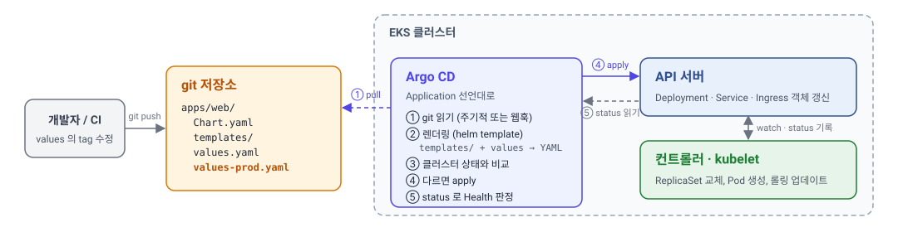
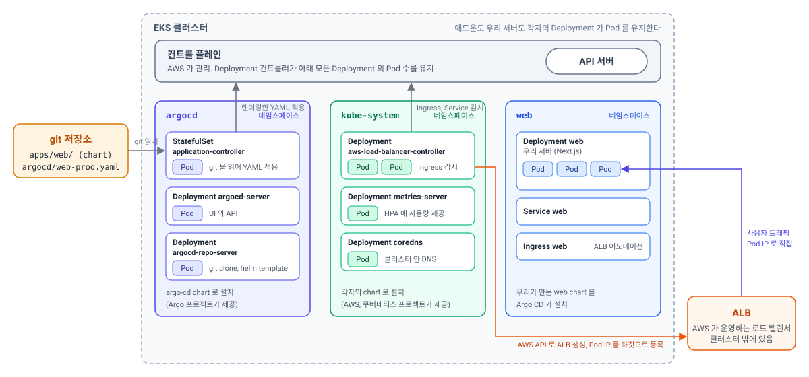
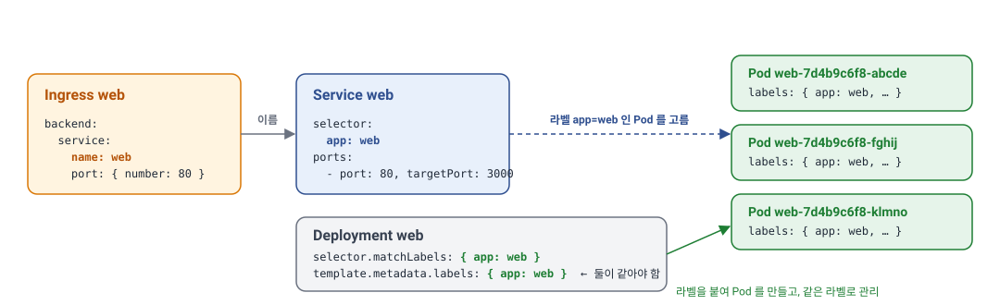

> **TL;DR**
>
> - Helm과 Argo CD를 쓰는 환경이라면 `kubectl apply`를 실행하는 것이 아니라 **git에 커밋을 하면 배포됩니다**. 커밋한 YAML을 Argo CD가 읽어 클러스터에 적용합니다.
> - **Helm**은 쿠버네티스 YAML을 템플릿으로 만드는 도구입니다. **chart**는 Helm이 읽는 폴더입니다. 빈자리를 둔 YAML 템플릿과 그 자리에 넣을 values 파일이 들어 있습니다.
>   ```text
>   web/                    # 이 폴더 하나가 chart
>     Chart.yaml            # chart 이름, 버전
>     values.yaml           # 기본값
>     values-dev.yaml       # dev 에서 기본값과 다른 값만
>     values-prod.yaml      # prod 에서 기본값과 다른 값만
>     templates/            # 값 자리를 비워 둔 YAML
>       deployment.yaml
>       service.yaml
>       ingress.yaml
>   ```
>   - `templates/`: Deployment, Service, Ingress 같은 YAML을 넣어 두는 폴더입니다. 환경마다 달라지는 자리만 `{{ .Values.image.tag }}`처럼 비워 둡니다.
>     ```yaml
>     # templates/deployment.yaml 일부
>     replicas: {{ .Values.replicaCount }}          # 환경마다 다르다 → values
>     image: web:{{ .Values.image.tag }}
>     readinessProbe:                               # 환경이 달라도 같다 → 템플릿에 고정
>       httpGet: { path: /api/health/ready, port: http }
>     ```
>   - `values.yaml`: 그 빈자리에 들어갈 기본값입니다. 이미지 태그, Pod 수, 메모리, 도메인 같은 값을 키로 적습니다.
>     ```yaml
>     # values.yaml
>     replicaCount: 2
>     image:
>       tag: "1.2.3"
>     ```
>   - `values-dev.yaml`, `values-prod.yaml`: 환경마다 기본값과 다른 값만 적습니다. 여기 없는 키는 `values.yaml`의 값을 그대로 씁니다.
>   - 프로브, `preStop`처럼 환경이 달라도 같은 설정은 템플릿에 고정하고, 메모리 limit, Pod 수, 도메인, 환경 변수처럼 환경마다 다른 것만 values로 뺍니다.
>   - 템플릿의 빈자리에 values 값을 채워 완성된 YAML을 만드는 것을 **렌더링**이라고 합니다. 템플릿은 하나지만 어떤 values 파일로 채우느냐에 따라 dev용 YAML, prod용 YAML이 따로 나옵니다.
> - **Argo CD**는 git을 지켜보다가 클러스터가 git과 다르면 git대로 맞추는 컨트롤러입니다. 배포는 `values-prod.yaml`의 이미지 태그를 바꿔 커밋하면 되고, 그 커밋을 revert하면 롤백이 됩니다.

Helm과 Argo CD를 쓰는 환경에서는 완성된 YAML을 손으로 쓰지 않고, `kubectl apply`도 사람이 실행하지 않습니다. 이 글에서는 Deployment, Service, Ingress 설정이 어떤 파일에 적히고 어떤 경로로 클러스터에 들어가는지를 살펴봅니다.

## 배포 흐름 한눈에 보기
Helm과 Argo CD로 서버 하나를 배포하는 흐름은 다음과 같습니다.



1. 코드가 머지되면 CI가 Docker 이미지를 빌드해 레지스트리(이미지 저장소. AWS에서는 ECR)에 올립니다.
2. 배포를 시작하면 CI가 매니페스트 저장소(쿠버네티스 YAML과 chart를 모아 둔 git 저장소)의 `values-prod.yaml`에서 이미지 태그를 새 태그로 바꿔 커밋합니다.
3. Argo CD가 그 커밋을 읽어 Helm chart의 템플릿에 values 값을 채워 완성된 YAML을 만들고, 그 YAML을 API 서버에 적용합니다.
4. Deployment 컨트롤러가 롤링 업데이트를 시작하고, 새 Pod가 프로브를 통과하면 이전 Pod가 내려갑니다.

Deployment, Service, Ingress, HPA 같은 YAML은 이 그림에서 Helm chart 안의 **템플릿**이 됩니다. 그 YAML 안의 값 중 환경마다 다른 것만 **values 파일**에 따로 적고, 템플릿에는 그 자리를 비워 둡니다. 사람이 `kubectl apply`를 실행하던 자리는 **Argo CD**가 대신합니다.

## Helm이 무엇인가
Helm은 쿠버네티스 YAML을 템플릿으로 만들어, 값만 바꿔 여러 번 설치할 수 있게 하는 패키지 관리자입니다. **chart**는 그 템플릿과 기본값을 정해진 폴더 구조로 묶은 것입니다. npm에 빗대면 Helm이 npm이고 chart가 패키지입니다.

Helm이 왜 필요한지는 환경이 둘 이상이 되면 바로 드러납니다. dev, stage, prod 세 환경에 같은 서버를 올리면 Deployment, Service, Ingress, ConfigMap 네 장이 환경마다 필요합니다. 그런데 환경마다 다른 값은 이미지 태그, Pod 수, 메모리, 도메인, API 주소 정도이고 나머지는 같습니다.

YAML을 세 벌 복사해 두면 프로브 설정 하나를 고칠 때도 세 파일을 모두 고쳐야 하고, 한 곳을 빠뜨리면 환경마다 설정이 달라집니다. Helm은 공통 부분을 템플릿 한 벌에 두고, 환경마다 다른 값만 별도 파일에 둡니다.

### chart의 구조
chart는 정해진 구조의 폴더 하나입니다. `helm create web`으로 뼈대를 만들 수 있지만, 생성되는 템플릿이 꽤 복잡합니다. 아래처럼 필요한 것만 남기고 시작하는 편이 읽기 쉽습니다.

```text
web/
  Chart.yaml              # chart 이름, 버전
  values.yaml             # 기본값
  values-dev.yaml         # 환경별로 덮어쓸 값. 기본값을 dev 에 맞춰 두면 거의 비어 있다
  values-prod.yaml
  templates/
    deployment.yaml       # 값 자리를 비워 둔 YAML
    service.yaml
    ingress.yaml
    configmap.yaml
    hpa.yaml              # autoscaling.enabled 일 때만 렌더링
```

```yaml
# Chart.yaml
apiVersion: v2
name: web
version: 0.1.0            # chart 자체의 버전
appVersion: "1.2.3"       # 담긴 애플리케이션의 버전. 기본 이미지 태그로 쓸 수 있음
```

### 템플릿과 values
템플릿은 평범한 YAML에 `{{ }}`로 값 자리를 비워 둔 것입니다. `.Values`는 values 파일의 내용이고, `.Release.Name`과 `.Chart.AppVersion`처럼 Helm이 채워 주는 값도 있습니다. `templates/service.yaml`을 예로 보면 다음과 같습니다.

```yaml
# templates/service.yaml
apiVersion: v1
kind: Service
metadata:
  name: {{ .Release.Name }}
  namespace: {{ .Release.Namespace }}
spec:
  type: ClusterIP
  selector:
    app: {{ .Release.Name }}
  ports:
    - name: http
      port: 80
      targetPort: http
```

`.Release.Name`은 설치할 때 붙이는 이름입니다. 이 chart를 `web`이라는 이름으로 설치하면 Service 이름도 `web`이 됩니다. Deployment와 Pod 라벨도 같은 값으로 렌더링되므로 서로 어긋날 일이 없습니다. 이름과 라벨이 왜 맞아야 하는지는 [부록](#부록-yaml-읽는-법)에 정리했습니다.

렌더링은 템플릿의 `{{ }}` 자리에 values 값을 채워 완성된 YAML을 만드는 것입니다. 템플릿 파일 하나에서 YAML 하나가 나오므로 `templates/deployment.yaml`에서 Deployment가, `templates/service.yaml`에서 Service가 나옵니다. 템플릿은 하나인데 values 파일을 바꿔 끼우면 dev용 YAML과 prod용 YAML이 따로 나옵니다.

values는 chart를 만드는 사람이 키 이름을 정하는 평범한 YAML입니다. `replicaCount`는 쿠버네티스에 없는 단어이고, 템플릿에서 `replicas: {{ .Values.replicaCount }}`로 연결해 줘야 의미가 생깁니다. 그래서 values 파일만 보고는 무엇이 어디로 가는지 알 수 없고, 템플릿과 짝지어 읽어야 합니다.

> **템플릿 문법에서 자주 보이는 네 가지**
>
> - `{{ .Values.x }}`: 값을 끼워 넣습니다.
> - `{{- if }}` … `{{- end }}`: 조건에 따라 줄을 넣거나 뺍니다.
> - `toYaml`: values의 한 덩어리를 YAML 그대로 옮깁니다.
> - `nindent 12`: 그 덩어리 앞에 줄바꿈을 하나 넣고 12칸 들여씁니다.
>
> `{{-`의 `-`는 앞의 줄바꿈과 공백을 지우라는 뜻으로, 없으면 빈 줄이 남습니다. `{{-`가 지운 줄바꿈을 `nindent`가 다시 넣어 주므로 `{{-`와 `nindent`는 세트로 씁니다.

`values-prod.yaml`처럼 환경별 파일을 주면 `values.yaml`의 기본값 위에 키 단위로 덮어씁니다. `image.tag`만 적으면 `image.repository`는 기본값이 그대로 남으므로, 환경별 파일에는 기본값과 다른 키만 적으면 됩니다.

### 렌더링과 설치
Helm 명령은 `helm <동사> [NAME] [CHART] [flags]` 형식입니다. NAME과 CHART는 이 순서로 적어야 하고, flags는 `-`로 시작하므로 어디에 와도 됩니다. 자주 쓰는 동사는 `template`, `upgrade --install`, `history`, `rollback` 넷입니다.

#### helm template: 렌더링
템플릿과 값이 합쳐진 결과는 `helm template`으로 확인합니다. `helm template`은 클러스터에 아무것도 보내지 않고 완성된 YAML만 출력합니다. 그래서 chart를 고친 뒤 의도대로 렌더링되는지 확인할 때 가장 자주 씁니다.

```bash
helm template web ./web -n web -f ./web/values-prod.yaml --set image.tag=1.2.4
```

- `web` (NAME): release(설치 단위) 이름입니다. 템플릿의 `.Release.Name`에 들어가므로 Deployment, Service 이름이 모두 `web`이 됩니다.
- `./web` (CHART): chart 폴더입니다.
- `-n web` (flags): 네임스페이스입니다. `.Release.Namespace`에 들어갑니다.
- `-f ./web/values-prod.yaml` (flags): `values.yaml` 위에 덮어쓸 환경별 values 파일입니다.
- `--set image.tag=1.2.4` (flags): 값 하나를 명령줄에서 덮어씁니다. 파일보다 우선하므로 `values-prod.yaml`에 적힌 태그가 있어도 이 값이 들어갑니다.

#### helm upgrade --install: 클러스터에 적용
Helm에서 설치(install)는 렌더링한 YAML을 API 서버에 보내 클러스터에 객체를 만드는 것으로, `kubectl apply`가 하는 일과 같습니다. 직접 설치할 때는 `helm upgrade --install`을 씁니다. `--install`을 붙이면 처음에는 설치하고, 이미 설치되어 있으면 업데이트합니다. 처음 설치만 하는 `helm install`도 있지만, `upgrade --install`이 그 경우까지 포함하므로 보통 `upgrade --install`만 씁니다. 이렇게 설치된 결과를 **release**라고 부릅니다.

```bash
helm upgrade --install web ./web -n web --create-namespace -f ./web/values-prod.yaml --set image.tag=1.2.4
```

`--create-namespace`는 네임스페이스가 없으면 만들라는 뜻입니다. 나머지는 `helm template`과 같습니다.

#### helm history, helm rollback: 기록과 되돌리기
Helm에는 별도 데이터베이스가 없습니다. 대신 release마다 어떤 값으로 어떤 YAML을 보냈는지를 클러스터 안의 Secret(비밀번호처럼 노출되면 안 되는 값을 담는 객체)에 버전별로 남겨 둡니다. `helm history`로 그 기록을 보고, `helm rollback`으로 이전 버전의 YAML을 다시 적용합니다.

```bash
helm history web -n web          # 1, 2, 3 ... 버전별 배포 기록
helm rollback web 2 -n web       # 2번 버전의 YAML 을 다시 적용. 기록에는 새 버전으로 쌓인다
```

다만 뒤에서 볼 Argo CD를 쓰면 설치와 되돌리기 명령을 사람이 실행하지 않습니다. Argo CD가 `helm template`으로 YAML을 뽑아 직접 적용하므로, 손에 익혀야 하는 것은 `helm template` 하나입니다.

## 서버 설정을 chart에 옮기기
Next.js 서버 하나를 띄우는 데 필요한 설정을 하나씩 chart에 옮기면서, 무엇을 템플릿에 고정하고 무엇을 values로 빼는지 살펴보겠습니다. 기준은 **환경이 달라도 같은 값은 템플릿에, 환경마다 다른 값은 values에** 두는 것입니다. values로 빼는 키가 많아질수록 템플릿만 봐서는 완성된 YAML을 알 수 없게 되므로, 실제로 환경마다 다른 것만 뺍니다. 아래 표의 values 키 이름은 이 chart에서 정한 것입니다. 그중 `replicaCount`, `image.*`, `autoscaling.*`은 `helm create`가 만드는 뼈대의 관례를 따랐습니다.

| 설정 | 들어가는 템플릿 | values 키 | 환경마다 다른가 |
| --- | --- | --- | --- |
| startup, liveness, readiness 프로브 | `deployment.yaml` | 없음 | 아니오 |
| `preStop` sleep | `deployment.yaml` | 없음 | 아니오 |
| `terminationGracePeriodSeconds` | `deployment.yaml`, `ingress.yaml` | `terminationGracePeriodSeconds` | 아니오. 두 곳에 같은 값을 쓰기 위해 뺌 |
| `resources` | `deployment.yaml` | `resources` | 예 |
| `NODE_OPTIONS` 힙 상한 | `deployment.yaml` | `nodeOptions` | 예. 메모리 limit에 따라감 |
| `replicas`, HPA | `deployment.yaml`, `hpa.yaml` | `replicaCount`, `autoscaling.*` | 예 |
| ALB 어노테이션, 도메인 | `ingress.yaml` | `ingress.scheme`, `ingress.host` | 일부 |
| 환경 변수 | `configmap.yaml` | `config` | 예 |
| Secret | chart 밖 | 없음 | 해당 없음. 외부 비밀 저장소에 둠 |

### Deployment: 프로브, 리소스, 종료
컨테이너 설정을 템플릿 한 장에 모으면 다음과 같습니다. 프로브와 `preStop`은 환경이 달라도 같으므로 그대로 적고, 리소스와 힙 상한, 유예 시간만 `.Values`로 뺐습니다.

```yaml
# templates/deployment.yaml
apiVersion: apps/v1
kind: Deployment
metadata:
  name: {{ .Release.Name }}
  namespace: {{ .Release.Namespace }}
  labels:
    app: {{ .Release.Name }}
spec:
  {{- if not .Values.autoscaling.enabled }}
  replicas: {{ .Values.replicaCount }}       # HPA 를 쓰는 환경에서는 이 줄이 렌더링되지 않는다
  {{- end }}
  selector:
    matchLabels:
      app: {{ .Release.Name }}
  minReadySeconds: 10
  strategy:
    type: RollingUpdate
    rollingUpdate: { maxSurge: 1, maxUnavailable: 0 }
  template:
    metadata:
      labels:
        app: {{ .Release.Name }}
      annotations:
        # ConfigMap 내용이 바뀌면 이 값이 바뀌어 롤링 업데이트가 일어난다
        checksum/config: {{ include (print $.Template.BasePath "/configmap.yaml") . | sha256sum }}
    spec:
      terminationGracePeriodSeconds: {{ .Values.terminationGracePeriodSeconds }}
      containers:
        - name: web
          image: "{{ .Values.image.repository }}:{{ .Values.image.tag | default .Chart.AppVersion }}"
          ports:
            - name: http
              containerPort: 3000
          env:
            - name: NODE_ENV
              value: production
            - name: NODE_OPTIONS
              value: {{ .Values.nodeOptions | quote }}
          envFrom:
            - configMapRef:
                name: {{ .Release.Name }}-config
            - secretRef:
                name: {{ .Release.Name }}-secret
          resources:
            {{- toYaml .Values.resources | nindent 12 }}
          startupProbe:
            httpGet: { path: /api/health/live, port: http }
            periodSeconds: 2
            failureThreshold: 30
          livenessProbe:
            httpGet: { path: /api/health/live, port: http }
            periodSeconds: 10
            timeoutSeconds: 3
            failureThreshold: 3
          readinessProbe:
            httpGet: { path: /api/health/ready, port: http }
            periodSeconds: 5
            timeoutSeconds: 3
            failureThreshold: 2
            successThreshold: 2
          lifecycle:
            preStop:
              exec:
                command: ['sleep', '10']
```

Deployment YAML에는 `spec`이 바깥과 안쪽에 하나씩 있습니다. 바깥 `spec`은 Deployment 자체의 설정으로, Pod를 몇 개 유지하고 어떤 방식으로 교체할지를 적습니다. 안쪽 `spec.template`은 Pod 하나의 설계도로, 어떤 컨테이너를 어떤 설정으로 띄울지를 적습니다. `template` 아래 내용은 Pod YAML에서 `apiVersion`과 `kind`를 뺀 것과 같아서, `spec` 아래에 다시 `metadata`와 `spec`이 나오는 모양이 됩니다. Deployment는 이 설계도를 복사해 `replicas` 수만큼 Pod를 만듭니다.

> **`image` 태그는 왜 values에 두고 `latest`는 피하나**
>
> 이미지 태그는 배포할 때마다 바뀌는 값이고, 배포가 곧 이 값을 바꾸는 커밋이므로 반드시 values에 둡니다. 태그를 `latest`로 두거나 생략하는 것도 피합니다. 태그가 그대로면 새 이미지를 올려도 YAML은 바뀐 것이 없습니다. 쿠버네티스는 YAML이 바뀌지 않으면 Pod를 교체하지 않으므로 새 이미지가 배포되지 않습니다. 게다가 태그가 `latest`거나 없으면 `imagePullPolicy` 기본값이 `Always`가 되어 컨테이너가 시작될 때마다 레지스트리를 조회합니다. 그래서 재시작 시점에 따라 Pod마다 다른 이미지가 도는 일도 생깁니다.

> **`NODE_OPTIONS`는 왜 `resources`와 함께 values에 두나**
>
> `NODE_OPTIONS`의 `--max-old-space-size`는 Node.js 힙 상한으로, 보통 메모리 limit의 75% 정도로 잡습니다. limit에 따라 정해지는 값이라 prod에서 limit을 올리면 힙 상한도 같이 올려야 합니다. 둘을 values에 나란히 두면 한 파일에서 같이 고치게 되어 한쪽만 바꾸는 실수를 줄일 수 있습니다. 환경 변수 값은 문자열이어야 하므로, 템플릿에서는 `quote`로 값에 따옴표를 씌워 문자열로 넘깁니다.

> **`checksum/config` 어노테이션은 무엇인가**
>
> ConfigMap만 바꿔서는 서버에 반영되지 않는 문제를 해결하는 장치입니다.
>
> - 환경 변수는 Pod가 시작될 때 ConfigMap에서 한 번 읽어 옵니다. 그래서 ConfigMap 값을 바꿔도 이미 떠 있는 Pod는 옛날 값을 그대로 가지고 있습니다.
> - Pod가 새로 뜨려면 롤링 업데이트가 일어나야 하는데, 롤링 업데이트는 Deployment의 `template`이 바뀔 때만 일어납니다. ConfigMap은 Deployment 밖의 객체라 아무리 바꿔도 `template`은 그대로입니다.
> - 그래서 ConfigMap 내용의 해시값을 `template`의 어노테이션에 적어 둡니다. ConfigMap이 바뀌면 해시값이 바뀌고, 해시값이 바뀌면 `template`이 바뀐 것이 되어 롤링 업데이트가 일어납니다. Helm 공식 문서에서 권장하는 방법입니다.

### HPA와 replicas
HPA를 쓰면 Deployment의 `replicas`를 빼야 합니다. 적어 두면 `kubectl apply`를 할 때마다 HPA가 조절해 둔 Pod 수가 그 값으로 되돌아가기 때문입니다. Argo CD에서는 HPA가 Pod 수를 바꾸는 순간 git과 어긋난 것으로 보고 git 값으로 되돌리므로, 이 되돌림이 더 자주 일어납니다. chart에서는 `replicas`를 넣을지 뺄지를 조건으로 처리합니다. `autoscaling.enabled`가 참이면 Deployment에서 `replicas` 줄이 빠지고 HPA가 렌더링되며, 거짓이면 반대입니다. dev는 Pod 두 개로 고정하고 prod만 HPA를 켜는 식의 구성이 values 한 줄로 정해집니다.

```yaml
# templates/hpa.yaml
{{- if .Values.autoscaling.enabled }}
apiVersion: autoscaling/v2
kind: HorizontalPodAutoscaler
metadata:
  name: {{ .Release.Name }}
  namespace: {{ .Release.Namespace }}
spec:
  scaleTargetRef: { apiVersion: apps/v1, kind: Deployment, name: {{ .Release.Name }} }
  minReplicas: {{ .Values.autoscaling.minReplicas }}
  maxReplicas: {{ .Values.autoscaling.maxReplicas }}
  metrics:
    - type: Resource
      resource:
        name: cpu
        target: { type: Utilization, averageUtilization: {{ .Values.autoscaling.targetCPUUtilizationPercentage }} }
{{- end }}
```

파일 전체가 `if` 안에 있어서 조건이 거짓이면 빈 파일이 되고, Helm은 빈 결과를 객체로 만들지 않습니다.

### Ingress와 ALB 어노테이션
Ingress는 어느 도메인의 어느 경로를 어느 Service로 보낼지를 적는 객체이고, 실제 트래픽을 받는 것은 그 선언을 보고 만들어진 ALB입니다. 그런데 "ALB를 사내망에만 열어라", "헬스체크는 이 경로로 해라" 같은 ALB 전용 옵션은 Ingress 스펙에 적을 자리가 없습니다. 대신 `metadata.annotations`에 `alb.ingress.kubernetes.io/` 접두어가 붙은 키로 적습니다. AWS Load Balancer Controller가 그 어노테이션을 읽어 ALB에 반영합니다. 아래 템플릿의 어노테이션 다섯 줄이 모두 이런 ALB 옵션입니다.

다섯 줄 중 환경마다 다른 것은 `scheme` 하나입니다. dev는 사내망에서만 열고(`internal`) prod는 인터넷에 여는(`internet-facing`) 경우가 많아 values로 뺐습니다. 헬스체크 경로와 주기, 타깃 타입은 환경이 달라도 같으므로 템플릿에 고정했습니다. 도메인은 어노테이션이 아니라 `spec.rules.host`에 적는데, 이것도 환경마다 다르므로 values로 뺐습니다.

등록 해제 대기 시간(`deregistration_delay.timeout_seconds`)은 내려가는 Pod로 가는 새 요청을 ALB가 끊은 뒤, 진행 중인 요청이 끝나기를 기다리는 시간입니다. 이 값이 `terminationGracePeriodSeconds`보다 길면 Pod가 먼저 죽어 버리므로, 유예 시간을 넘지 않게 잡아야 합니다. 그래서 Deployment와 Ingress 템플릿이 같은 values 키를 읽어 둘 다 45초가 되게 했습니다. 고칠 곳이 한 군데라 둘이 어긋날 일이 없습니다.

```yaml
# templates/ingress.yaml
apiVersion: networking.k8s.io/v1
kind: Ingress
metadata:
  name: {{ .Release.Name }}
  namespace: {{ .Release.Namespace }}
  annotations:
    alb.ingress.kubernetes.io/scheme: {{ .Values.ingress.scheme }}
    alb.ingress.kubernetes.io/target-type: ip
    alb.ingress.kubernetes.io/healthcheck-path: /api/health/ready
    alb.ingress.kubernetes.io/healthcheck-interval-seconds: '10'
    alb.ingress.kubernetes.io/target-group-attributes: deregistration_delay.timeout_seconds={{ .Values.terminationGracePeriodSeconds }}
spec:
  ingressClassName: alb
  rules:
    - host: {{ .Values.ingress.host }}
      http:
        paths:
          - path: /
            pathType: Prefix
            backend:
              service: { name: {{ .Release.Name }}, port: { number: 80 } }
```

### ConfigMap과 환경 변수
환경 변수는 Deployment의 `env`에 하나씩 적을 수도 있습니다. 하지만 API 주소나 기능 플래그처럼 환경마다 다르고 개수도 늘어나는 값은 ConfigMap이라는 별도 객체에 모아 둡니다. Deployment에서는 `envFrom`으로 그 ConfigMap을 통째로 불러옵니다. `env`가 이름과 값을 하나씩 적는 필드라면, `envFrom`은 ConfigMap이나 Secret의 키 전부를 환경 변수로 넣는 필드입니다.

```yaml
# Deployment 의 컨테이너 설정
env:                              # 하나씩
  - name: NODE_ENV
    value: production
envFrom:                          # 통째로
  - configMapRef:
      name: web-config            # 이 ConfigMap 의 키 전부
  - secretRef:
      name: web-secret            # 이 Secret 의 키 전부
---
# ConfigMap web-config
data:
  API_BASE_URL: https://api.example.com
  FEATURE_X: "true"
```

이렇게 두면 컨테이너 안에는 `NODE_ENV`, `API_BASE_URL`, `FEATURE_X`와 `web-secret`의 키들이 모두 환경 변수로 들어가고, 어느 쪽에서 왔는지는 구분되지 않습니다. ConfigMap에 키를 추가하면 Deployment를 고치지 않아도 환경 변수가 늘어납니다.

> **`web-secret`은 어디서 오나**
>
> 비밀 값은 chart에 넣지 않습니다. Secret의 `data`는 base64 인코딩일 뿐 암호화가 아니라서 git에 올리면 그대로 노출되기 때문입니다. 대신 AWS Secrets Manager 같은 외부 저장소에 값을 둡니다. External Secrets Operator 같은 컨트롤러가 그 값을 읽어 클러스터 안에 `web-secret`이라는 Secret을 만듭니다. Deployment는 그 이름만 `secretRef`로 참조합니다.

ConfigMap의 `data`에 들어갈 키와 값은 환경마다 다르므로 values에 적습니다. 이 chart에서는 values의 `config` 아래에 적은 내용이 그대로 `data`가 되도록 템플릿을 만들었습니다.

```yaml
# templates/configmap.yaml
apiVersion: v1
kind: ConfigMap
metadata:
  name: {{ .Release.Name }}-config
  namespace: {{ .Release.Namespace }}
data:
  {{- toYaml .Values.config | nindent 2 }}
```

환경 변수는 전부 문자열이므로 values에서도 `"true"`, `"3000"`처럼 따옴표를 붙여야 합니다. 따옴표 없이 적으면 YAML이 불리언이나 숫자로 읽어 적용이 거부됩니다.

### values 파일
지금까지의 템플릿이 읽는 values 키를 한곳에 모으면 다음 두 파일이 됩니다. `values.yaml`에는 dev 기준의 기본값을 모두 적고, `values-prod.yaml`에는 prod에서 기본값과 다른 키만 적습니다.

```yaml
# values.yaml (기본값. dev 기준)
replicaCount: 2
image:
  repository: registry.example.com/web
  tag: ""                       # 비우면 Chart.yaml 의 appVersion
autoscaling:
  enabled: false
  minReplicas: 3
  maxReplicas: 10
  targetCPUUtilizationPercentage: 60
resources:
  requests: { cpu: 250m, memory: 512Mi }
  limits: { memory: 1Gi }
nodeOptions: --max-old-space-size=768
terminationGracePeriodSeconds: 45   # preStop 10초 + 요청 정리 여유
ingress:
  scheme: internal
  host: dev.example.com
config:
  API_BASE_URL: https://api-dev.example.com
  FEATURE_NEW_HEADER: "true"
```

```yaml
# values-prod.yaml (prod 에서 덮어쓸 값만)
image:
  tag: "1.2.3"                  # CI 가 배포마다 이 줄을 바꿔 커밋한다
autoscaling:
  enabled: true
resources:
  requests: { cpu: 500m, memory: 1Gi }
  limits: { memory: 2Gi }
nodeOptions: --max-old-space-size=1536
ingress:
  scheme: internet-facing
  host: example.com
config:
  API_BASE_URL: https://api.example.com
  FEATURE_NEW_HEADER: "false"
```

`autoscaling.enabled: true` 한 줄이 Deployment의 `replicas`를 지우고 HPA 객체를 만든다는 것은 템플릿을 봐야 알 수 있습니다. 반대로 템플릿을 고칠 때는 모든 환경에 영향이 간다는 점을 염두에 둬야 합니다. 프로브 시간을 바꾸는 커밋은 dev, stage, prod에 모두 적용됩니다.

## Argo CD가 무엇인가
Argo CD는 git 저장소에 있는 매니페스트(또는 chart)와 클러스터의 실제 상태를 계속 비교하고, 다르면 git대로 맞추는 컨트롤러입니다. 사람이 `kubectl apply`나 `helm upgrade`를 실행하는 자리를 대신합니다.

### push와 pull
완성된 YAML을 누가 어디서 API 서버에 보내느냐에 따라 배포 방식은 세 가지로 나뉩니다.

| 방법 | 누가 보내나 | 클러스터 자격 증명이 있는 곳 |
| --- | --- | --- |
| 내 컴퓨터에서 `kubectl apply` / `helm upgrade` | 사람 | 개발자 노트북 |
| CI(GitHub Actions)에서 `kubectl apply` / `helm upgrade` | CI 러너 | CI 시크릿 |
| Argo CD | 클러스터 안의 컨트롤러 | 클러스터 안 |

앞의 둘은 바깥에서 클러스터로 미는 **push** 방식이고, Argo CD는 클러스터 안에서 git을 보고 가져오는 **pull** 방식입니다. push 방식은 단순하지만 CI에 클러스터를 바꿀 수 있는 자격 증명을 둬야 하고, 누가 언제 무엇을 적용했는지가 CI 로그에 흩어집니다. pull 방식은 자격 증명이 클러스터 밖으로 나가지 않고, git이 곧 배포 기록이 됩니다. 이 방식을 **GitOps**라고 부릅니다.

### Argo CD가 하는 일
Argo CD는 클러스터 안에 설치되는 컨트롤러입니다. 다른 컨트롤러와 다른 점은 클러스터 객체에 더해 git 저장소까지 지켜본다는 것입니다.



공식 설치 매니페스트나 Helm chart(argo-helm)를 설치하면 Argo CD 구성 요소가 `argocd` 네임스페이스에 Pod로 만들어집니다. 별도 서비스가 아니라 클러스터 안에서 돌고, `web`과 마찬가지로 컨트롤러가 Pod 수를 유지합니다. Argo CD가 하는 일은 순서대로 다음과 같습니다.

1. git 저장소의 지정한 경로를 주기적으로(기본 2~3분, 120초에 최대 60초의 무작위 지연을 더한 값) 읽습니다. 웹훅을 걸면 push 즉시 읽습니다.
2. 그 경로가 Helm chart면 `helm template`으로, 평범한 YAML이면 그대로 렌더링해 **git이 원하는 상태**를 만듭니다.
3. 클러스터에서 같은 객체들을 읽어 **현재 상태**와 비교합니다. 둘이 다르면 OutOfSync(git과 클러스터가 어긋난 상태)로 표시합니다.
4. 자동 동기화가 켜져 있으면 렌더링한 객체를 API 서버에 `apply`합니다. 그 뒤는 `kubectl apply`를 했을 때와 똑같이 컨트롤러와 kubelet의 몫입니다.

Argo CD는 Helm의 `install`을 쓰지 않고 `template`으로 YAML만 뽑아 직접 적용합니다. 그래서 `helm list`에는 아무것도 나오지 않고, `helm rollback`도 쓸 수 없습니다. Argo CD 화면에는 이전 커밋으로 되돌리는 롤백 메뉴가 있습니다. 하지만 자동 동기화가 켜져 있으면 되돌려도 곧바로 최신 커밋으로 다시 맞춰지므로, Argo CD는 자동 동기화를 끄기 전에는 롤백을 받아 주지 않습니다. 롤백은 git에서 커밋을 되돌려서 합니다.

### Application 선언
Argo CD에 "이 저장소의 이 경로를 이 클러스터의 이 네임스페이스에 맞춰라"고 알려 주는 것도 YAML입니다. 이 YAML은 Argo CD가 추가한 Application이라는 객체이고, 환경마다 하나씩 만듭니다. 아래는 prod용입니다.

```yaml
# argocd/web-prod.yaml
apiVersion: argoproj.io/v1alpha1
kind: Application
metadata:
  name: web-prod
  namespace: argocd                      # Application 객체 자체는 argocd 네임스페이스에
spec:
  project: default
  source:
    repoURL: https://github.com/example/k8s-manifests.git
    targetRevision: main                 # 브랜치 또는 태그
    path: apps/web                       # chart 가 있는 경로
    helm:
      releaseName: web                   # 생략하면 Application 이름(web-prod)이 release 이름이 됨
      valueFiles:
        - values-prod.yaml               # path 기준 상대 경로
  destination:
    server: https://kubernetes.default.svc   # Argo CD 가 설치된 클러스터 자신
    namespace: web
  syncPolicy:
    automated:
      prune: true                        # git 에서 지운 객체는 클러스터에서도 지움
      selfHeal: true                     # 누가 kubectl 로 고쳐도 git 대로 되돌림
    syncOptions:
      - CreateNamespace=true             # web 네임스페이스가 없으면 만듦
```

- `source`: 어디서 읽을지 정합니다. 저장소, 브랜치, chart 경로, values 파일을 적습니다.
- `destination`: 어디에 적용할지 정합니다. 클러스터와 네임스페이스를 적습니다.
- `syncPolicy`: 차이를 발견했을 때 어떻게 할지 정합니다.
  - `automated`: 자동으로 적용할지 정합니다. 없으면 차이만 보여 주고, 사람이 UI에서 Sync 버튼을 눌러야 적용됩니다.
    - `prune`: git에서 지운 객체를 클러스터에서도 지울지 정합니다. 기본은 꺼져 있어서 지운 객체가 클러스터에 남습니다.
    - `selfHeal`: 임의로 `kubectl edit`으로 고친 것을 git대로 되돌릴지 정합니다. 기본은 꺼져 있어서 고친 것이 그대로 유지됩니다.
- `helm.releaseName`: 템플릿의 `.Release.Name`에 들어갈 값입니다. 생략하면 Deployment, Service, Ingress 이름이 모두 `web-prod`가 되므로 `web`으로 고정합니다.

### Synced와 Healthy
Argo CD 화면은 Application마다 Sync와 Health 두 가지 상태를 보여 줍니다.

| 상태 | 묻는 것 | 값 |
| --- | --- | --- |
| Sync | git과 클러스터의 **선언**이 같은가 | Synced, OutOfSync, Unknown |
| Health | 선언대로 **실제로 돌고** 있는가 | Healthy, Progressing, Degraded, Suspended, Missing, Unknown |

- Sync: git에 적힌 필드(라벨과 어노테이션 포함)를 클러스터 객체의 같은 필드와 비교한 결과입니다. `status`나 클러스터가 채운 기본값은 비교하지 않습니다.
- Health: 객체의 `status`를 읽은 결과입니다. Deployment라면 `kubectl rollout status`와 같은 기준으로 판정합니다.
  - Progressing: Pod 교체가 진행 중입니다. 배포 직후에는 git이 반영된 상태라 Synced이면서 Progressing입니다.
  - Healthy: 새 Pod가 readiness 프로브를 통과하고(`minReadySeconds`가 있으면 그만큼 더 지나) 이전 Pod가 모두 내려간 상태입니다. Health 판정도 결국 readiness 프로브가 기준입니다.
  - Degraded: 새 Pod가 계속 `CrashLoopBackOff`여서 Deployment의 `progressDeadlineSeconds`(기본 600초) 안에 교체를 끝내지 못한 상태입니다.

## git, chart, Argo CD의 관계
세 가지가 어떻게 이어지는지를 저장소 구조에서 시작해 살펴보겠습니다.

### 저장소 두 개
흔한 구성은 앱 코드 저장소와 매니페스트 저장소를 나누는 것입니다. 앱 저장소에는 코드와 Dockerfile을, 매니페스트 저장소에는 chart와 Application을 둡니다. Argo CD는 매니페스트 저장소만 바라봅니다.

```text
web/                            # 앱 코드 저장소
  src/
  Dockerfile
  .github/workflows/deploy.yml  # 이미지 빌드 → 레지스트리 push → 매니페스트 저장소에 태그 커밋

k8s-manifests/                  # 매니페스트 저장소. Argo CD 가 바라보는 곳
  apps/
    web/                        # 위에서 만든 Helm chart
      Chart.yaml
      values.yaml
      values-dev.yaml
      values-prod.yaml
      templates/
  argocd/
    web-dev.yaml                # Application. apps/web 을 values-dev.yaml 로 dev 네임스페이스에
    web-prod.yaml               # Application. apps/web 을 values-prod.yaml 로 web 네임스페이스에
```

앱 코드와 매니페스트를 다른 저장소에 두는 이유는 두 가지입니다.

- 코드가 머지됐다고 바로 배포되면 안 되는 경우가 있습니다. 머지는 오늘 하고 배포는 내일 하는 식입니다.
- 매니페스트 저장소의 커밋 기록이 곧 배포 기록이 됩니다. 코드 커밋이 섞여 있으면 어느 커밋이 배포였는지 가려내야 합니다.

### 배포는 커밋 한 줄
앱 코드와 매니페스트를 나눈 구조에서 **배포는 git 커밋**입니다. 코드가 머지되면 CI는 이미지를 빌드해 올려 두기만 합니다. 배포할 때는 `values-prod.yaml`의 `image.tag`를 그 이미지 태그로 바꿔 커밋합니다. 이 커밋은 배포 워크플로를 실행한 CI가 만들어도 되고 사람이 직접 만들어도 됩니다. 커밋이 머지되면 Argo CD가 읽어 Deployment를 갱신하고 롤링 업데이트가 시작됩니다. 이미지를 올리고 git에 커밋하는 것까지가 클러스터 밖의 일이고, 클러스터에 넣는 것은 Argo CD의 일입니다.

```diff
 # values-prod.yaml
 image:
-  tag: "1.2.3"
+  tag: "1.2.4"
```

CI가 커밋을 만드는 구성이라면 사람이 하는 일은 그 커밋을 리뷰하고 머지하는 것뿐입니다. 되돌리고 싶으면 커밋을 revert합니다. revert 커밋이 머지되면 Argo CD가 이전 태그로 렌더링해 적용하고, 롤링 업데이트가 한 번 더 일어나 이전 이미지로 돌아갑니다. `kubectl`로 클러스터만 이전 상태로 되돌려도 `selfHeal`이 켜져 있으면 수 초 안에 git 상태로 되돌아갑니다.

### 무엇을 바꾸려면 어디를 고치나
저장소의 각 위치가 무엇을 책임지는지를 표로 정리하면 다음과 같습니다.

| 바꾸고 싶은 것 | 고치는 곳 |
| --- | --- |
| 코드 | 앱 저장소. 배포를 시작하면 CI가 `values-<env>.yaml`의 `image.tag`를 커밋 |
| 메모리 limit, Pod 수, 도메인, 환경 변수 | `values-<env>.yaml` |
| 프로브 시간, `preStop`, 어노테이션 구조 | `templates/` |
| 어느 브랜치의 어느 경로를 어느 클러스터에 | `argocd/*.yaml` |

템플릿을 고치는 커밋은 모든 환경에 동시에 적용되므로, 구조를 바꿀 때는 values로 빼서 dev에서 먼저 켜 보는 쪽이 안전합니다.

## 부록: YAML 읽는 법
본문의 템플릿에 나온 쿠버네티스 YAML 필드를 정리한 부록입니다. 필드가 낯설 때 참고하면 됩니다.

### 네 필드
쿠버네티스 YAML은 종류가 무엇이든 `apiVersion`, `kind`, `metadata`로 시작하고, 그 아래에 `spec`이 옵니다. `spec`은 Deployment, Service처럼 원하는 상태를 적는 종류에만 있고, ConfigMap, Secret처럼 값만 담는 종류는 `spec` 자리에 `data`가 옵니다.

```yaml
apiVersion: apps/v1       # 이 리소스가 속한 API 그룹과 버전
kind: Deployment          # 리소스 종류
metadata:                 # 이름, 네임스페이스, 라벨 같은 식별 정보
  name: web
  namespace: web
  labels:
    app: web
spec:                     # 원하는 상태. 내용은 kind 마다 다름
  replicas: 3
```

`apiVersion`은 "API 그룹/버전" 형식입니다. 쿠버네티스 API는 객체 종류를 주제별 그룹에 나눠 담습니다. 그래서 Deployment는 `apps/v1`, Ingress는 `networking.k8s.io/v1`, HorizontalPodAutoscaler는 `autoscaling/v2`처럼 그룹 이름이 앞에 붙습니다. Pod, Service, ConfigMap처럼 처음부터 있던 종류는 이름 없는 핵심 그룹에 있어 `v1`만 적습니다. 어떤 종류가 어느 그룹에 있는지는 외우기보다 `kubectl api-resources`로 찾는 편이 빠릅니다.

`metadata.name`은 같은 네임스페이스의 같은 종류 안에서 유일해야 합니다.

`spec` 아래에 어떤 필드가 들어가는지는 `kind`마다 다릅니다. 문서를 뒤지는 대신 `kubectl explain`으로 바로 볼 수 있습니다.

```bash
kubectl explain deployment.spec
kubectl explain deployment.spec.strategy.rollingUpdate
```

`status`는 YAML에 쓰지 않습니다. 컨트롤러와 kubelet이 현재 상태를 적는 자리라서, `kubectl get deployment web -o yaml`로 꺼내 보면 직접 쓴 적 없는 `status.readyReplicas` 같은 값이 들어 있습니다. 이 출력을 그대로 저장해 다시 `apply`하면 `resourceVersion` 같은 자동 생성 필드 때문에 충돌 에러가 날 수 있습니다. 저장소에는 직접 쓴 `spec`까지만 둡니다.

### 이름과 라벨로 이어지는 고리
객체가 다른 객체를 가리키는 방식은 이름과 라벨 두 가지입니다. 이 chart에서는 `metadata.name`과 `metadata.labels.app`이 둘 다 `web`으로 렌더링되지만 성격이 다릅니다. 이름은 객체 하나를 가리키는 주소이고, 라벨은 여러 객체를 묶는 분류 꼬리표입니다.

HTML에 비유하면 이름은 `id`, 라벨은 `data-*` 속성입니다. `getElementById`로 하나를 집듯 이름으로는 객체 하나를 가리키고, `querySelectorAll('[data-app="web"]')`로 여러 개를 모으듯 라벨로는 조건에 맞는 객체를 모두 고릅니다.

| | `metadata.name` | `metadata.labels.app` |
| --- | --- | --- |
| 필수 여부 | 필수 | 선택 |
| 유일성 | 같은 네임스페이스의 같은 종류 안에서 유일 | 같은 값을 여러 객체가 가질 수 있음 |
| 변경 | 만든 뒤 바꿀 수 없음 | 언제든 추가, 수정, 삭제 가능 |
| 쓰는 쪽 | 특정 객체 하나를 가리킬 때 | 조건에 맞는 객체 여러 개를 고를 때 |
| 예 | `kubectl get deployment web` | `kubectl get all -l app=web` |

상대가 하나로 정해져 있으면 이름으로 가리킵니다. Ingress가 트래픽을 보낼 Service, Deployment가 읽을 ConfigMap이 그렇습니다. 상대가 여러 개이거나 개수가 변하면 라벨로 고릅니다. Pod는 Deployment가 `web-7d4f9-abc12`처럼 임의 이름으로 만들고, 그 이름도 수시로 바뀝니다. 그래서 이름으로 가리킬 수 없고, Service와 Deployment는 `selector`로 `app: web` 라벨이 붙은 Pod를 모두 고릅니다.

라벨로 고르는 자리가 여럿이라 Deployment 템플릿 안에는 `app: web`이 세 번 나옵니다.

- `metadata.labels`: Deployment 객체 자신의 라벨입니다. 분류에만 쓰이므로 지워도 동작에 영향이 없습니다.
- `spec.selector.matchLabels`: 이 Deployment가 관리할 Pod를 고르는 조건입니다.
- `spec.template.metadata.labels`: 만들어질 Pod에 붙는 라벨입니다.

뒤의 둘은 Pod를 찾는 고리라서 어긋나면 바로 문제가 납니다.

트래픽이 Ingress에서 Pod까지 가려면 Ingress, Service, Deployment가 이 두 방식으로 이어져 있어야 합니다.



```yaml
# Ingress → Service: 이름으로
backend:
  service: { name: web, port: { number: 80 } }
---
# Service → Pod: 라벨로
kind: Service
spec:
  selector: { app: web }
  ports:
    - port: 80            # Service 의 포트
      targetPort: http    # 컨테이너 포트. containerPort 의 이름 또는 번호
---
# Deployment → Pod: 라벨로
kind: Deployment
spec:
  selector:
    matchLabels: { app: web }
  template:
    metadata:
      labels: { app: web }
```

Ingress는 Service를 **이름**으로 가리킵니다. 같은 네임스페이스에 그 이름의 Service가 있어야 합니다. Service는 Pod를 **라벨**로 고릅니다. `selector`에 적은 라벨을 모두 가진 Pod가 EndpointSlice에 들어갑니다. Deployment도 Pod를 라벨로 고릅니다. Pod는 `template.metadata.labels`에 적힌 라벨을 달고 만들어집니다. 그래서 `template.metadata.labels`에는 `selector.matchLabels`의 라벨이 모두 들어 있어야 하고, 빠지면 API 서버가 Deployment 생성을 거부합니다. Deployment의 `selector`는 한 번 만들면 바꿀 수 없으므로 처음부터 바뀌지 않을 라벨로 정합니다.

이 고리에서 가장 흔한 사고는 Service의 `selector`와 Pod 라벨이 어긋나는 것입니다. 이때는 아무 에러도 나지 않습니다. Deployment도 Pod도 멀쩡하고 Service도 만들어지는데, EndpointSlice에 Pod IP가 하나도 없어 트래픽만 가지 않습니다. 본문의 chart 템플릿이 이름과 라벨을 모두 `.Release.Name` 하나에서 렌더링하는 이유가 이것입니다. 값이 같아야 해서가 아니라, 한 곳에서 나오게 해 서로 어긋날 일을 없애기 위해서입니다.

### 종류별 주요 필드
이 chart의 템플릿에 나오는 필드만 종류별로 모았습니다. 모든 종류에 공통인 `apiVersion`, `kind`, `metadata`는 뺐고, 본문에서 길게 다룬 필드는 짧게 적고 해당 절로 링크했습니다.

**Deployment** ([본문](#deployment-프로브-리소스-종료))

| 필드 | 역할 |
| --- | --- |
| `spec.replicas` | 유지할 Pod 수. HPA를 쓰면 적지 않음 |
| `spec.selector.matchLabels` | 이 Deployment가 관리할 Pod를 고르는 라벨. 만든 뒤 변경 불가 |
| `spec.minReadySeconds` | 새 Pod가 Ready가 된 뒤 이 시간을 버텨야 가용으로 봄 |
| `spec.strategy.rollingUpdate` | `maxSurge`는 정원 초과 허용 수, `maxUnavailable`은 정원 미달 허용 수 |
| `spec.template.metadata.labels` | 만들어질 Pod에 붙는 라벨. `selector`와 일치해야 함 |
| `spec.template.metadata.annotations` | Pod 어노테이션. `checksum/config`로 ConfigMap이 바뀌면 Pod 교체 |
| `spec.template.spec.terminationGracePeriodSeconds` | 종료가 시작된 뒤 강제 종료까지 기다리는 시간. `preStop` 실행 시간도 이 안에 포함 |
| `spec.template.spec.containers[].image` | 컨테이너 이미지. `저장소:태그` |
| `….containers[].ports` | 컨테이너가 여는 포트. 이름을 붙이면 Service와 프로브가 이름으로 참조 |
| `….containers[].env`, `envFrom` | 환경 변수. `env`는 개별 값, `envFrom`은 ConfigMap이나 Secret 통째로 |
| `….containers[].resources` | CPU와 메모리의 `requests`(보장)와 `limits`(상한) |
| `….containers[].startupProbe`, `livenessProbe`, `readinessProbe` | 기동 완료, 생존, 트래픽 수신 가능 판정 |
| `….containers[].lifecycle.preStop` | 종료 신호를 보내기 전에 실행할 동작 |

**Service**

| 필드 | 역할 |
| --- | --- |
| `spec.type` | 노출 범위. `ClusterIP`는 클러스터 안에서만 접근 가능 |
| `spec.selector` | 트래픽을 보낼 Pod를 고르는 라벨 |
| `spec.ports[].port` | Service가 받는 포트 |
| `spec.ports[].targetPort` | 트래픽을 넘길 컨테이너 포트. 번호 또는 `containerPort`의 이름 |

**Ingress** ([본문](#ingress와-alb-어노테이션))

| 필드 | 역할 |
| --- | --- |
| `metadata.annotations` | Ingress 컨트롤러에 주는 옵션. `alb.ingress.kubernetes.io/*`는 ALB 설정 |
| `spec.ingressClassName` | 이 Ingress를 처리할 컨트롤러. `alb`면 AWS Load Balancer Controller |
| `spec.rules[].host` | 이 규칙이 적용될 도메인 |
| `spec.rules[].http.paths[].path`, `pathType` | 경로 조건. `Prefix`는 앞부분 일치 |
| `spec.rules[].http.paths[].backend.service` | 트래픽을 넘길 Service의 이름과 포트 |

**HorizontalPodAutoscaler** ([본문](#hpa와-replicas))

| 필드 | 역할 |
| --- | --- |
| `spec.scaleTargetRef` | Pod 수를 조절할 대상. 보통 Deployment |
| `spec.minReplicas`, `maxReplicas` | Pod 수의 하한과 상한 |
| `spec.metrics[]` | 판단 기준. `Resource` 타입은 평균 CPU 사용률이 목표치를 넘으면 늘림 |

**ConfigMap** ([본문](#configmap과-환경-변수))

| 필드 | 역할 |
| --- | --- |
| `data` | 키와 값. 값은 모두 문자열이어야 함 |

## 부록: 적용 전에 확인하는 명령
chart를 고친 뒤 커밋하기 전에 직접 실행해 보는 명령입니다. 위에서부터 렌더링, 검증, 차이 확인 순입니다.

```bash
# chart 가 어떤 YAML 로 렌더링되는지 보기. chart 를 고쳤으면 환경별 values 를 바꿔 가며 확인
helm template web ./web -n web -f ./web/values-prod.yaml

# 렌더링 결과를 API 서버까지 보내되 저장하지 않음. 스키마 검증과 어드미션 웹훅까지 통과하는지 확인
helm template web ./web -n web -f ./web/values-prod.yaml | kubectl apply -f - --dry-run=server

# 렌더링 결과를 적용하면 무엇이 바뀌는지 미리 보기. 바뀌는 것이 없으면 출력도 없다
helm template web ./web -n web -f ./web/values-prod.yaml | kubectl diff -f -

# 필드 이름과 타입 확인
kubectl explain deployment.spec.template.spec.containers.resources

# 클러스터에 실제로 들어간 YAML. status 와 자동 생성 필드가 함께 나온다
kubectl get deployment web -n web -o yaml

# Argo CD 가 보는 git 과 클러스터의 차이
argocd app diff web-prod
```

##### 참고
- [https://helm.sh/docs/topics/charts/](https://helm.sh/docs/topics/charts/)
- [https://helm.sh/docs/chart_template_guide/](https://helm.sh/docs/chart_template_guide/)
- [https://helm.sh/docs/howto/charts_tips_and_tricks/](https://helm.sh/docs/howto/charts_tips_and_tricks/)
- [https://argo-cd.readthedocs.io/en/stable/user-guide/application-specification/](https://argo-cd.readthedocs.io/en/stable/user-guide/application-specification/)
- [https://argo-cd.readthedocs.io/en/stable/user-guide/auto_sync/](https://argo-cd.readthedocs.io/en/stable/user-guide/auto_sync/)
- [https://argo-cd.readthedocs.io/en/stable/user-guide/sync-options/](https://argo-cd.readthedocs.io/en/stable/user-guide/sync-options/)
- [https://argo-cd.readthedocs.io/en/stable/user-guide/helm/](https://argo-cd.readthedocs.io/en/stable/user-guide/helm/)
- [https://argo-cd.readthedocs.io/en/stable/operator-manual/health/](https://argo-cd.readthedocs.io/en/stable/operator-manual/health/)
- [https://kubernetes.io/docs/concepts/overview/working-with-objects/](https://kubernetes.io/docs/concepts/overview/working-with-objects/)
- [https://kubernetes.io/docs/concepts/overview/working-with-objects/labels/](https://kubernetes.io/docs/concepts/overview/working-with-objects/labels/)
- [https://kubernetes.io/docs/concepts/configuration/configmap/](https://kubernetes.io/docs/concepts/configuration/configmap/)
- [https://external-secrets.io/latest/](https://external-secrets.io/latest/)
