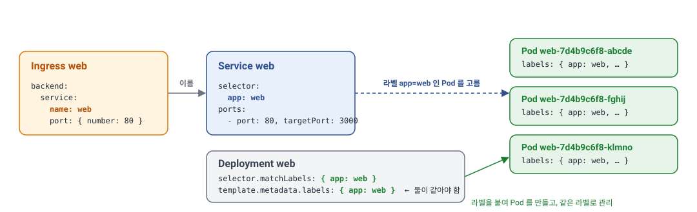
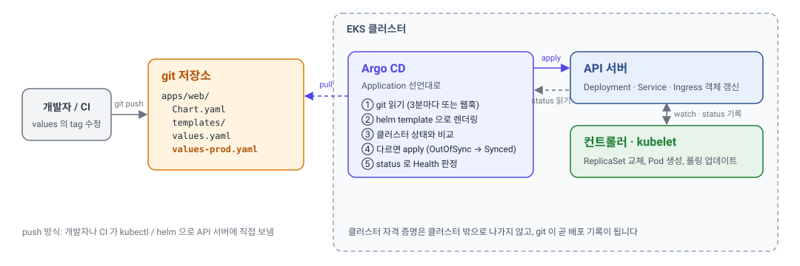

> **TL;DR**
>
> - 모든 쿠버네티스 YAML은 **`apiVersion`, `kind`, `metadata`, `spec`** 네 필드로 시작합니다. `spec`은 사람이 적는 "원하는 상태"이고 `status`는 클러스터가 적는 "현재 상태"라 YAML에 쓰지 않습니다.
> - 객체는 **이름과 라벨**로 이어집니다. Ingress는 Service를 이름으로 가리키고, Service는 Pod를 라벨로 고르고, Deployment의 `selector`와 `template.metadata.labels`는 같아야 합니다. 이 고리 중 하나가 어긋나면 에러 없이 트래픽만 안 갑니다.
> - 환경이 여러 개면 YAML을 복사하지 않고 **Helm chart**로 템플릿을 만듭니다. 공통 구조는 `templates/`에, 환경마다 다른 값은 `values-*.yaml`에 둡니다. `helm template`으로 완성된 YAML을 확인할 수 있습니다.
> - **Argo CD**는 git 저장소를 지켜보다가 바뀐 YAML(또는 chart)을 렌더링해 API 서버에 보내는 컨트롤러입니다. 사람이 `kubectl apply`를 치는 대신 git에 올리는 것으로 배포가 끝나고, 클러스터 상태가 git과 다르면 Argo CD가 알려 주거나 되돌립니다.

앞 글 [쿠버네티스 구조](/tech/etc/kubernetes/)에서 Deployment로 선언한 것을 컨트롤러가 Pod로 만들고 kubelet이 띄운다는 것을, 그 다음 글에서 프로브와 롤링 업데이트로 Pod가 트래픽을 받고 내려가는 과정을 살펴봤습니다. 이 글은 그 선언 자체를 다룹니다. 우리가 쓰는 YAML이 어떻게 생겼고, 환경이 여러 개가 되면 어떻게 관리하며, 어떤 경로로 클러스터에 들어가는지입니다.

아래는 이 글을 읽는 데 도움이 되는 자주 나오는 용어입니다.

- **객체**: 클러스터 안에 실제로 존재하는 것 하나. YAML 한 덩어리가 객체 하나가 됩니다.
- **라벨**: 객체에 붙이는 `key: value` 꼬리표. 다른 객체가 이것으로 골라냅니다.
- **API 서버**: 모든 YAML이 도착하는 곳. `kubectl`, Helm, Argo CD 모두 결국 여기에 요청을 보냅니다.

## YAML의 뼈대
쿠버네티스 YAML은 종류가 무엇이든 같은 네 필드로 시작합니다.

```yaml
apiVersion: apps/v1       # 이 리소스가 속한 API 그룹과 버전
kind: Deployment          # 리소스 종류
metadata:                 # 이름, 네임스페이스, 라벨 같은 식별 정보
  name: web
  namespace: web
  labels:
    app: web
spec:                     # 원하는 상태. 내용은 kind 마다 다름
  replicas: 3
```

`apiVersion`은 어느 API 그룹에서 이 종류를 찾을지 알려 줍니다. Deployment는 `apps/v1`, Service와 ConfigMap은 `v1`, Ingress는 `networking.k8s.io/v1`, HorizontalPodAutoscaler는 `autoscaling/v2`입니다. 외우기보다는 `kubectl api-resources`로 찾는 편이 빠릅니다. `kind`는 리소스 종류이고, `metadata.name`은 같은 네임스페이스의 같은 종류 안에서 유일해야 합니다.

`spec`이 YAML의 몸통입니다. 어떤 필드가 들어가는지는 `kind`마다 다르고, 어떤 필드가 있는지는 문서를 뒤지는 대신 `kubectl explain`으로 바로 볼 수 있습니다.

```bash
kubectl explain deployment.spec
kubectl explain deployment.spec.strategy.rollingUpdate
```

`status`는 YAML에 쓰지 않습니다. 컨트롤러와 kubelet이 현재 상태를 적는 자리라서, `kubectl get deployment web -o yaml`로 꺼내 보면 우리가 쓴 적 없는 `status.readyReplicas` 같은 값이 들어 있습니다. 반대로 이 출력을 그대로 파일에 저장해 다시 `apply`하면 `status`와 자동 생성 필드가 섞여 지저분해지므로, 저장소에는 우리가 쓴 `spec`까지만 둡니다.

### 라벨과 어노테이션
`metadata` 아래 `labels`와 `annotations`는 둘 다 `key: value` 쌍이지만 쓰임이 다릅니다.

| | 라벨 (labels) | 어노테이션 (annotations) |
| --- | --- | --- |
| 용도 | 객체를 **골라내는** 기준 | 객체에 **메모**를 붙이는 자리 |
| 누가 읽나 | Service의 `selector`, Deployment의 `selector`, `kubectl get -l` | 컨트롤러와 애드온. 사람이 보는 설명도 여기에 |
| 예 | `app: web`, `tier: frontend` | `alb.ingress.kubernetes.io/scheme: internet-facing` |

라벨은 선택에 쓰이므로 값이 짧고 규칙적이어야 합니다. 어노테이션은 선택에 쓰이지 않아 긴 값도 괜찮고, 앞 글에서 본 ALB 옵션처럼 특정 컨트롤러에게 보내는 설정이 주로 여기에 들어갑니다.

### 여러 객체를 한 파일에
YAML은 `---` 한 줄로 문서를 나눌 수 있어서, 한 파일에 Deployment와 Service를 함께 둘 수 있습니다. `kubectl apply -f`에 파일 대신 폴더를 주면 그 안의 YAML을 모두 적용합니다.

```yaml
apiVersion: apps/v1
kind: Deployment
metadata: { name: web, namespace: web }
spec: { ... }
---
apiVersion: v1
kind: Service
metadata: { name: web, namespace: web }
spec: { ... }
```

```bash
kubectl apply -f web.yaml      # 파일 하나
kubectl apply -f ./manifests/  # 폴더 안의 모든 YAML
```

## Deployment 한 장 뜯어보기
앞 두 글에서 조각조각 나온 필드를 Deployment 한 장에 모으면 다음과 같습니다. 주석이 붙은 줄이 이 글에서 설명하는 부분입니다.

```yaml
apiVersion: apps/v1
kind: Deployment
metadata:
  name: web
  namespace: web
  labels:
    app: web
spec:
  replicas: 3                       # HPA 를 쓰면 이 줄은 뺀다
  revisionHistoryLimit: 10
  selector:                         # 이 Deployment 가 관리할 Pod 를 고르는 기준
    matchLabels:
      app: web
  strategy:
    type: RollingUpdate
    rollingUpdate:
      maxSurge: 1
      maxUnavailable: 0
  template:                         # 이 아래가 만들어질 Pod 의 명세
    metadata:
      labels:
        app: web                    # selector 와 반드시 일치
    spec:
      containers:
        - name: web
          image: registry.example.com/web:1.2.3
          ports:
            - containerPort: 3000
          env:
            - name: NODE_ENV
              value: production
            - name: PORT
              value: "3000"         # env 값은 항상 문자열
          envFrom:
            - configMapRef:
                name: web-config
            - secretRef:
                name: web-secret
          resources:
            requests: { cpu: 250m, memory: 512Mi }
            limits: { memory: 1Gi }
          startupProbe:
            httpGet: { path: /api/health/live, port: 3000 }
            periodSeconds: 2
            failureThreshold: 30
          livenessProbe:
            httpGet: { path: /api/health/live, port: 3000 }
            periodSeconds: 10
            timeoutSeconds: 3
          readinessProbe:
            httpGet: { path: /api/health/ready, port: 3000 }
            periodSeconds: 5
      terminationGracePeriodSeconds: 30
```

구조는 두 겹입니다. 바깥 `spec`은 Deployment의 설정으로 몇 개를 어떻게 교체할지를 적고, 안쪽 `spec.template`은 Pod의 명세로 무엇을 띄울지를 적습니다. `template` 아래는 `kind: Pod` YAML에서 `apiVersion`과 `kind`만 뺀 것과 같습니다. 그래서 `spec` 아래에 다시 `spec`이 나오는 모양이 됩니다.

컨테이너 설정에서 자주 헷갈리는 것 몇 가지만 짚습니다.

- **`image` 태그.** `latest`나 태그 없는 이미지는 피합니다. 같은 YAML을 다시 적용해도 쿠버네티스는 바뀐 것이 없다고 보아 Pod를 교체하지 않고, 노드마다 다른 버전이 떠 있을 수 있습니다. 태그가 `latest`면 `imagePullPolicy` 기본값이 `Always`가 되어 Pod를 만들 때마다 이미지를 다시 받는 것도 느려지는 원인입니다. 빌드마다 고유한 태그를 붙이고 YAML의 태그를 바꿔 배포합니다.
- **`env` 값은 문자열.** `value: 3000`처럼 따옴표 없이 적으면 YAML이 숫자로 읽어 적용이 거부됩니다. 환경 변수는 전부 문자열이라 `"3000"`, `"true"`처럼 따옴표를 붙입니다.
- **리소스 단위.** CPU `250m`은 0.25코어입니다. 메모리 `512Mi`는 2의 거듭제곱 단위(메비바이트)이고 `512M`은 10의 거듭제곱 단위라 약 5% 차이가 납니다. 쿠버네티스에서는 관례적으로 `Mi`, `Gi`를 씁니다.
- **`ports`는 문서용.** `containerPort`를 적지 않아도 컨테이너의 포트는 열립니다. 이 값은 어떤 포트를 쓰는지 사람과 도구에게 알려 주는 선언이고, Service의 `targetPort`에 이름으로 참조할 때 쓰입니다.

### 이름과 라벨로 이어지는 고리
트래픽이 Ingress에서 Pod까지 가려면 객체 세 개가 서로를 가리켜야 합니다. 가리키는 방식이 두 가지라 헷갈리기 쉽습니다.



```yaml
# Ingress → Service: 이름으로
backend:
  service: { name: web, port: { number: 80 } }
---
# Service → Pod: 라벨로
kind: Service
spec:
  selector: { app: web }
  ports:
    - port: 80
      targetPort: 3000
---
# Deployment → Pod: 라벨로
kind: Deployment
spec:
  selector:
    matchLabels: { app: web }
  template:
    metadata:
      labels: { app: web }
```

Ingress는 Service를 **이름**으로 가리킵니다. 같은 네임스페이스에 그 이름의 Service가 있어야 합니다. Service는 Pod를 **라벨**로 고릅니다. `selector`에 적은 라벨을 모두 가진 Pod가 EndpointSlice에 들어갑니다. Deployment도 Pod를 라벨로 고르는데, 자기가 만드는 Pod에 그 라벨을 붙이므로 `selector.matchLabels`와 `template.metadata.labels`가 같아야 합니다. 다르면 적용 단계에서 거부됩니다.

이 고리에서 가장 흔한 사고는 Service의 `selector`와 Pod 라벨이 어긋나는 것입니다. 이때는 아무 에러도 나지 않습니다. Deployment도 Pod도 멀쩡하고 Service도 만들어지는데, EndpointSlice가 비어 있어 트래픽만 가지 않습니다. 앞 글의 장애 대응 절에서 `kubectl get endpointslices`를 먼저 보라고 한 이유입니다.

## Service와 Ingress
Service와 Ingress는 Deployment보다 짧습니다. 포트가 세 번 나오는데 각각 어디의 포트인지만 구분하면 됩니다.

```yaml
apiVersion: v1
kind: Service
metadata:
  name: web
  namespace: web
spec:
  type: ClusterIP            # 기본값. 클러스터 안에서만 접근
  selector:
    app: web
  ports:
    - name: http
      port: 80               # Service 가 여는 포트. 다른 Pod 는 web:80 으로 호출
      targetPort: 3000       # Pod 안 컨테이너의 포트. containerPort 이름으로도 가능
```

`port`는 Service의 포트, `targetPort`는 컨테이너의 포트입니다. 클러스터 안의 다른 Pod가 `http://web.web.svc.cluster.local:80`으로 부르면 Service가 Pod의 3000번으로 넘깁니다. Ingress의 `backend.service.port.number`는 이 중 Service의 `port`를 가리킵니다.

```yaml
apiVersion: networking.k8s.io/v1
kind: Ingress
metadata:
  name: web
  namespace: web
  annotations:
    alb.ingress.kubernetes.io/scheme: internet-facing
    alb.ingress.kubernetes.io/target-type: ip
    alb.ingress.kubernetes.io/healthcheck-path: /api/health/ready
spec:
  ingressClassName: alb
  rules:
    - host: example.com
      http:
        paths:
          - path: /
            pathType: Prefix
            backend:
              service:
                name: web
                port:
                  number: 80
```

`rules`는 "이 호스트의 이 경로는 이 Service로"라는 표이고, 어떤 컨트롤러가 이 표를 읽어 실제 로드 밸런서를 만들지는 `ingressClassName`이 정합니다. 어노테이션은 그 컨트롤러에게 주는 옵션이라 컨트롤러가 바뀌면 함께 바뀝니다.

## 설정과 비밀: ConfigMap과 Secret
환경 변수를 Deployment에 직접 적으면 값이 바뀔 때마다 Deployment를 고쳐야 하고, 비밀번호가 Deployment YAML에 그대로 남습니다. 그래서 설정은 ConfigMap, 비밀은 Secret으로 떼어 내고 Deployment는 이름으로 참조합니다.

```yaml
apiVersion: v1
kind: ConfigMap
metadata:
  name: web-config
  namespace: web
data:
  API_BASE_URL: https://api.example.com
  FEATURE_NEW_HEADER: "true"
---
apiVersion: v1
kind: Secret
metadata:
  name: web-secret
  namespace: web
type: Opaque
stringData:                        # 평문으로 적으면 저장될 때 base64 로 바뀜
  SESSION_SECRET: change-me
```

앞의 Deployment에서 `envFrom`으로 이 둘을 참조했으므로 `data`의 키가 그대로 환경 변수 이름이 됩니다. 키 하나만 가져오려면 `env[].valueFrom.configMapKeyRef`를 씁니다.

Secret에 대해 두 가지를 알아 두어야 합니다. 첫째, Secret의 `data`는 **base64 인코딩이지 암호화가 아닙니다.** `kubectl get secret web-secret -o yaml`을 볼 권한이 있는 사람은 누구나 디코딩할 수 있습니다. 보호는 RBAC(누가 Secret을 읽을 수 있는지)과 etcd 암호화 설정에서 합니다. 둘째, 그래서 Secret YAML은 git에 올리지 않습니다. 회사에서는 보통 AWS Secrets Manager 같은 외부 저장소에 값을 두고, External Secrets Operator 같은 컨트롤러가 그 값을 읽어 클러스터 안에 Secret 객체를 만들어 줍니다. git에는 "어느 외부 비밀을 어떤 이름의 Secret으로 만들라"는 선언만 올라갑니다.

ConfigMap 값을 바꿔도 **이미 떠 있는 Pod의 환경 변수는 바뀌지 않습니다.** 환경 변수는 프로세스가 시작할 때 한 번 읽히기 때문입니다. 새 값을 반영하려면 Pod를 다시 만들어야 하는데, ConfigMap만 바뀌면 Deployment의 `template`은 그대로라 롤링 업데이트가 일어나지 않습니다. 뒤에서 Helm으로 이 문제를 해결하는 방법이 나옵니다.

## 환경이 여러 개가 되면: Helm
dev, stage, prod 세 환경에 같은 서버를 올린다고 하면 Deployment, Service, Ingress, ConfigMap 네 장이 환경마다 필요합니다. 그런데 환경마다 다른 값은 이미지 태그, `replicas`, 도메인, API 주소 정도이고 나머지는 같습니다. YAML을 세 벌 복사하면 프로브 설정을 하나 고칠 때 세 군데를 고쳐야 하고, 머지않아 어긋납니다.

Helm은 이 문제를 **템플릿과 값의 분리**로 풉니다. 공통 구조는 템플릿에 두고, 환경마다 다른 값만 별도 파일에 둡니다. 이 묶음을 chart라고 부르고, Helm은 chart와 값을 합쳐 완성된 YAML을 만든 뒤 API 서버에 보냅니다. npm에 빗대면 Helm이 npm, chart가 패키지입니다.

### chart의 구조
chart는 정해진 구조의 폴더 하나입니다. `helm create web`으로 뼈대를 만들 수 있지만, 생성되는 템플릿이 꽤 복잡해서 아래처럼 필요한 것만 남기고 시작하는 편이 읽기 쉽습니다.

```text
web/
  Chart.yaml              # chart 이름, 버전
  values.yaml             # 기본값
  values-dev.yaml         # 환경별로 덮어쓸 값
  values-prod.yaml
  templates/
    deployment.yaml       # 값 자리를 비워 둔 YAML
    service.yaml
    ingress.yaml
    configmap.yaml
```

```yaml
# Chart.yaml
apiVersion: v2
name: web
version: 0.1.0            # chart 자체의 버전
appVersion: "1.2.3"       # 담긴 애플리케이션의 버전. 기본 이미지 태그로 쓸 수 있음
```

### 템플릿과 values
템플릿은 평범한 YAML에 `{{ }}`로 값 자리를 뚫어 둔 것입니다. `.Values`는 values 파일의 내용이고, `.Release.Name`과 `.Chart.AppVersion`처럼 Helm이 채워 주는 값도 있습니다.

```yaml
# templates/deployment.yaml
apiVersion: apps/v1
kind: Deployment
metadata:
  name: {{ .Release.Name }}
  namespace: {{ .Release.Namespace }}
spec:
  {{- if not .Values.autoscaling.enabled }}
  replicas: {{ .Values.replicaCount }}
  {{- end }}
  selector:
    matchLabels:
      app: {{ .Release.Name }}
  template:
    metadata:
      labels:
        app: {{ .Release.Name }}
      annotations:
        # ConfigMap 내용이 바뀌면 이 값이 바뀌어 롤링 업데이트가 일어난다
        checksum/config: {{ include (print $.Template.BasePath "/configmap.yaml") . | sha256sum }}
    spec:
      containers:
        - name: web
          image: "{{ .Values.image.repository }}:{{ .Values.image.tag | default .Chart.AppVersion }}"
          resources:
            {{- toYaml .Values.resources | nindent 12 }}
```

```yaml
# values.yaml (기본값)
replicaCount: 2
image:
  repository: registry.example.com/web
  tag: ""                 # 비우면 Chart.yaml 의 appVersion
autoscaling:
  enabled: false
resources:
  requests: { cpu: 250m, memory: 512Mi }
  limits: { memory: 1Gi }
ingress:
  host: dev.example.com
```

```yaml
# values-prod.yaml (prod 에서 덮어쓸 값만)
image:
  tag: "1.2.3"
autoscaling:
  enabled: true
ingress:
  host: example.com
```

템플릿 문법에서 자주 보이는 것은 네 가지입니다. `{{ .Values.x }}`는 값을 끼워 넣고, `{{- if }}`와 `{{- end }}`는 조건에 따라 줄을 넣거나 빼며, `toYaml`은 values의 한 덩어리를 YAML 그대로 옮기고, `nindent 12`는 그 덩어리를 12칸 들여씁니다. `{{-`의 `-`는 앞의 줄바꿈과 공백을 지우라는 뜻으로, 이것이 없으면 빈 줄이 남습니다.

주석을 단 `checksum/config` 줄은 앞 절의 ConfigMap 문제를 푸는 관용구입니다. ConfigMap 템플릿을 렌더링한 결과의 해시를 Pod 어노테이션에 넣어 두면, ConfigMap 값이 바뀔 때 Pod `template`도 함께 바뀌어 롤링 업데이트가 일어납니다.

값은 세 층으로 겹쳐집니다. `values.yaml`의 기본값 위에 `-f values-prod.yaml`로 준 파일이 덮어쓰고, 그 위에 `--set image.tag=1.2.4`처럼 명령줄로 준 값이 덮어씁니다. 환경별 파일에는 기본값과 다른 것만 적으면 됩니다.

### 렌더링, 설치, 롤백
템플릿과 값이 합쳐진 결과는 `helm template`으로 확인합니다. 클러스터에 아무것도 보내지 않고 완성된 YAML만 출력하므로, chart를 고친 뒤 의도대로 나오는지 보는 데 가장 자주 쓰는 명령입니다.

```bash
helm template web ./web -n web -f values-prod.yaml --set image.tag=1.2.4
```

설치와 업데이트는 `helm upgrade --install` 하나로 합니다. 처음이면 설치하고 이미 있으면 업데이트하라는 뜻입니다. Helm은 설치된 결과를 **release**라고 부르고, 어떤 값으로 어떤 YAML을 보냈는지를 네임스페이스 안의 Secret에 버전별로 기록합니다. 그래서 이전 버전으로 되돌리는 롤백이 간단합니다.

```bash
helm upgrade --install web ./web -n web -f values-prod.yaml --set image.tag=1.2.4
helm history web -n web          # 1, 2, 3 ... 버전별 배포 기록
helm rollback web 2 -n web       # 2번 버전의 YAML 을 다시 적용
helm uninstall web -n web        # chart 가 만든 객체를 모두 삭제
```

Helm 대신 쓰는 도구로 Kustomize가 있습니다. 템플릿 없이 기본 YAML에 환경별 패치를 겹치는 방식이고 `kubectl apply -k`로 kubectl에 들어 있습니다. 애드온처럼 남이 만든 것을 설치할 때는 대부분 Helm chart로 배포되므로, 회사가 Kustomize를 쓰더라도 Helm은 만나게 됩니다.

## 클러스터에 넣는 법: kubectl, CI, Argo CD
완성된 YAML을 API 서버에 보내는 방법은 셋입니다. 누가 어디서 보내느냐가 다릅니다.

| 방법 | 누가 보내나 | 클러스터 자격 증명이 있는 곳 |
| --- | --- | --- |
| 내 컴퓨터에서 `kubectl apply` / `helm upgrade` | 사람 | 개발자 노트북 |
| CI(GitHub Actions)에서 `kubectl apply` / `helm upgrade` | CI 러너 | CI 시크릿 |
| Argo CD | 클러스터 안의 컨트롤러 | 클러스터 안 |

앞의 둘은 바깥에서 클러스터로 미는 **push** 방식이고, Argo CD는 클러스터 안에서 git을 보고 가져오는 **pull** 방식입니다. push 방식은 단순하지만 CI에 클러스터를 바꿀 수 있는 자격 증명을 둬야 하고, 누가 언제 무엇을 적용했는지가 CI 로그에 흩어집니다. pull 방식은 자격 증명이 클러스터 밖으로 나가지 않고, git이 곧 배포 기록이 됩니다. 이 방식을 **GitOps**라고 부릅니다.

### Argo CD가 하는 일
Argo CD는 클러스터 안에 설치되는 컨트롤러입니다. 앞 글의 애드온과 같은 구조로, 지켜보는 대상이 쿠버네티스 객체가 아니라 git 저장소라는 점만 다릅니다.



1. git 저장소의 지정한 경로를 주기적으로(기본 3분) 읽습니다. 웹훅을 걸면 push 즉시 읽습니다.
2. 그 경로가 Helm chart면 `helm template`으로, 평범한 YAML이면 그대로 렌더링해 **git이 원하는 상태**를 만듭니다.
3. 클러스터에서 같은 객체들을 읽어 **현재 상태**와 비교합니다. 다르면 OutOfSync입니다.
4. 자동 동기화가 켜져 있으면 차이 나는 객체를 API 서버에 `apply`합니다. 그 뒤는 앞 글에서 본 대로 컨트롤러와 kubelet의 몫입니다.

Argo CD는 Helm의 `install`을 쓰지 않고 `template`으로 YAML만 뽑아 직접 적용합니다. 그래서 `helm list`에는 아무것도 나오지 않고, 롤백도 Helm이 아니라 Argo CD의 배포 기록이나 git 되돌리기로 합니다.

### Application 선언
Argo CD에게 "이 저장소의 이 경로를 이 클러스터의 이 네임스페이스에 맞춰라"고 알려 주는 것도 YAML입니다. Argo CD가 추가한 Application이라는 리소스입니다.

```yaml
apiVersion: argoproj.io/v1alpha1
kind: Application
metadata:
  name: web-prod
  namespace: argocd                      # Application 객체 자체는 argocd 네임스페이스에
spec:
  project: default
  source:
    repoURL: https://github.com/example/k8s-manifests.git
    targetRevision: main                 # 브랜치 또는 태그
    path: apps/web                       # chart 가 있는 경로
    helm:
      valueFiles:
        - values-prod.yaml
  destination:
    server: https://kubernetes.default.svc   # Argo CD 가 설치된 클러스터 자신
    namespace: web
  syncPolicy:
    automated:
      prune: true                        # git 에서 지운 객체는 클러스터에서도 지움
      selfHeal: true                     # 누가 kubectl 로 고쳐도 git 대로 되돌림
    syncOptions:
      - CreateNamespace=true
```

`source`가 어디서 읽을지, `destination`이 어디에 적용할지, `syncPolicy`가 차이를 발견했을 때 어떻게 할지입니다. `automated`가 없으면 차이만 보여 주고 사람이 UI에서 Sync 버튼을 눌러야 적용됩니다. `prune`과 `selfHeal`은 기본이 꺼져 있어서 켜지 않으면 git에서 지운 객체가 클러스터에 남고, 누가 `kubectl edit`으로 고친 것도 그대로 유지됩니다.

이 구조에서 **배포는 git 커밋**입니다. CI가 이미지를 빌드해 올린 뒤 `values-prod.yaml`의 `image.tag`를 새 태그로 바꿔 커밋하면, Argo CD가 그 커밋을 읽어 Deployment를 갱신하고 롤링 업데이트가 시작됩니다. 사람이 하는 일은 그 커밋을 리뷰하고 머지하는 것뿐이고, 되돌리고 싶으면 커밋을 revert합니다.

### Synced와 Healthy
Argo CD 화면에서 Application마다 두 가지 상태가 보입니다. 서로 다른 질문에 대한 답입니다.

| 상태 | 묻는 것 | 값 |
| --- | --- | --- |
| Sync | git과 클러스터의 **선언**이 같은가 | Synced, OutOfSync |
| Health | 선언대로 **실제로 돌고** 있는가 | Healthy, Progressing, Degraded, Missing |

Sync는 `spec`을 비교한 결과입니다. Health는 `status`를 읽은 결과로, Deployment라면 `readyReplicas`가 `replicas`에 도달했는지를 봅니다. 그래서 배포 직후에는 Synced이면서 Progressing이고, 새 Pod가 readiness 프로브를 통과하면 Healthy가 됩니다. 새 Pod가 계속 `CrashLoopBackOff`면 Deployment의 `progressDeadlineSeconds`(기본 600초)가 지난 뒤 Degraded로 바뀝니다. 앞 글의 프로브가 여기서도 판정 기준이 됩니다.

## 자주 하는 실수
- **selector와 라벨 불일치.** 에러 없이 트래픽만 안 갑니다. `kubectl get endpointslices -n web`이 비어 있으면 이것입니다.
- **네임스페이스 누락.** `metadata.namespace`를 빼면 현재 컨텍스트의 네임스페이스(보통 `default`)에 만들어집니다. Service가 다른 네임스페이스의 Pod를 고를 수는 없으므로 같은 서비스의 객체는 모두 같은 네임스페이스에 둡니다.
- **env 값에 따옴표 누락.** `value: 3000`, `value: true`는 적용이 거부됩니다. `"3000"`, `"true"`로 씁니다.
- **HPA가 있는데 `replicas`를 남김.** 배포할 때마다 YAML의 값으로 덮어써 HPA가 늘린 Pod가 줄어듭니다. HPA를 쓰면 `replicas` 줄을 지웁니다.
- **`latest` 태그.** 같은 YAML을 적용해도 Pod가 교체되지 않고, 어느 버전이 떠 있는지 알 수 없습니다.
- **Secret을 git에 커밋.** base64는 암호화가 아닙니다. 외부 비밀 저장소와 External Secrets 같은 도구로 분리합니다.
- **Argo CD가 있는데 `kubectl apply`로 직접 고침.** `selfHeal`이 켜져 있으면 몇 분 뒤 git 상태로 되돌아가고, 꺼져 있으면 OutOfSync로 남아 다음 배포 때 덮어써집니다. 고칠 것은 git에서 고칩니다.

## 부록: 적용 전에 확인하는 명령
```bash
# 필드 이름과 타입 확인
kubectl explain deployment.spec.template.spec.containers.resources

# 적용하면 무엇이 바뀌는지 미리 보기. 바뀌는 것이 없으면 출력도 없다
kubectl diff -f web.yaml

# 문법과 스키마만 검사하고 보내지 않음
kubectl apply -f web.yaml --dry-run=server

# chart 가 어떤 YAML 로 렌더링되는지 보기
helm template web ./web -n web -f values-prod.yaml

# 클러스터에 실제로 들어간 YAML. status 와 자동 생성 필드가 함께 나온다
kubectl get deployment web -n web -o yaml
```

##### 참고
- [https://kubernetes.io/docs/concepts/overview/working-with-objects/](https://kubernetes.io/docs/concepts/overview/working-with-objects/)
- [https://kubernetes.io/docs/concepts/overview/working-with-objects/labels/](https://kubernetes.io/docs/concepts/overview/working-with-objects/labels/)
- [https://kubernetes.io/docs/concepts/configuration/configmap/](https://kubernetes.io/docs/concepts/configuration/configmap/)
- [https://kubernetes.io/docs/concepts/configuration/secret/](https://kubernetes.io/docs/concepts/configuration/secret/)
- [https://kubernetes.io/docs/concepts/containers/images/](https://kubernetes.io/docs/concepts/containers/images/)
- [https://helm.sh/docs/topics/charts/](https://helm.sh/docs/topics/charts/)
- [https://helm.sh/docs/chart_template_guide/](https://helm.sh/docs/chart_template_guide/)
- [https://helm.sh/docs/howto/charts_tips_and_tricks/](https://helm.sh/docs/howto/charts_tips_and_tricks/)
- [https://argo-cd.readthedocs.io/en/stable/user-guide/application-specification/](https://argo-cd.readthedocs.io/en/stable/user-guide/application-specification/)
- [https://argo-cd.readthedocs.io/en/stable/user-guide/auto_sync/](https://argo-cd.readthedocs.io/en/stable/user-guide/auto_sync/)
- [https://argo-cd.readthedocs.io/en/stable/operator-manual/health/](https://argo-cd.readthedocs.io/en/stable/operator-manual/health/)
- [https://external-secrets.io/latest/](https://external-secrets.io/latest/)
