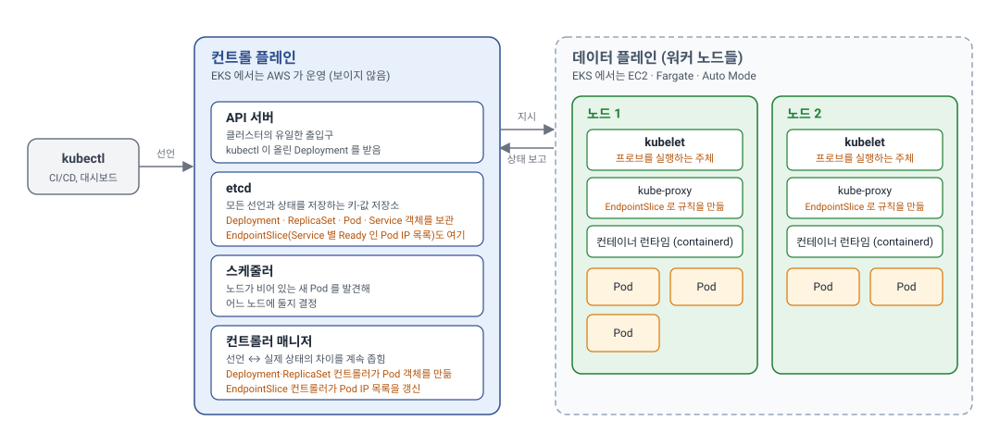
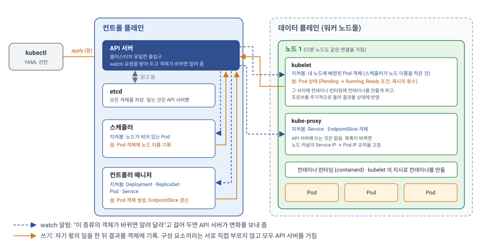
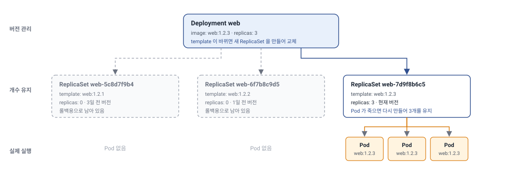
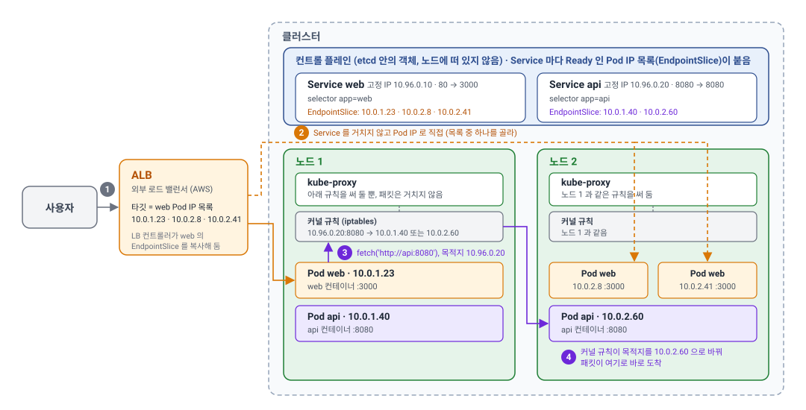
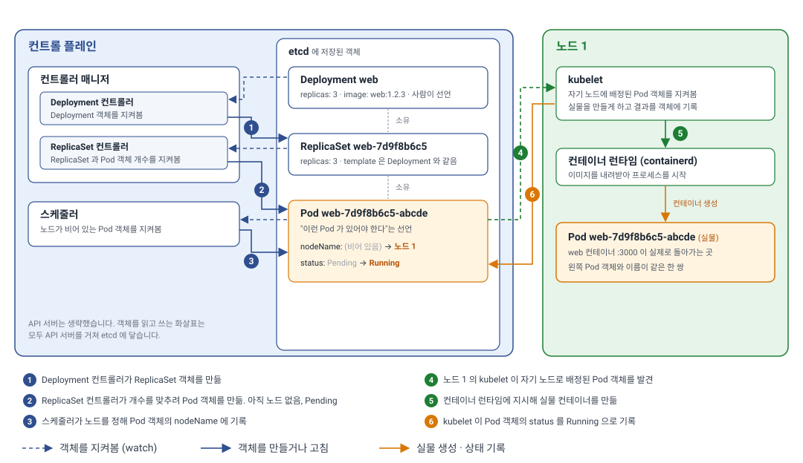

> **TL;DR**
>
> - 쿠버네티스는 컨테이너 오케스트레이터입니다. **클러스터**는 지시를 내리는 컨트롤 플레인 하나와 컨테이너를 실제로 돌리는 워커 노드 여러 대로 이루어지고, 노드 안에 **Pod**, Pod 안에 컨테이너가 들어갑니다. 우리는 원하는 상태(어떤 이미지를, Pod 몇 개로, 몇 번 포트에, 메모리는 얼마까지)를 Deployment 같은 리소스로 YAML에 선언하고, 쿠버네티스는 실제 상태를 거기에 계속 맞춥니다.
> - 컨트롤 플레인은 "무엇을" 정하고, 각 노드의 **kubelet**이 "실제로" 컨테이너를 띄웁니다. Deployment 같은 선언은 etcd에 저장되고, 컨트롤러 매니저가 그것을 Pod 객체로 만들고, 스케줄러가 노드를 정하고, 그 노드의 kubelet이 컨테이너 런타임에 컨테이너를 만들게 합니다.
> - Pod는 쿠버네티스가 배포하는 최소 단위이고 언제든 죽고 다시 만들어지는 일회용입니다. 같은 서버를 여러 개 띄우는 것은 Pod 복제본(`replicas`)이고, Pod 하나에 컨테이너 여러 개는 역할이 다른 프로세스를 묶는 것입니다. 같은 Pod 안의 컨테이너는 IP 하나를 공유하고 포트로 구분합니다. 트래픽은 Pod IP 목록(EndpointSlice)으로 분산되므로 분산 단위도 Pod입니다.
> - Pod를 직접 만들지 않고 **Deployment**로 선언합니다. Pod를 직접 만드는 것은 "지금 하나 띄워라"는 한 번의 명령이라 죽으면 끝이지만, Deployment는 "이 서버를 이런 모습으로 몇 개 띄워 두고 계속 유지하라"는 약속이라 쿠버네티스가 죽은 Pod를 다시 만들고 이미지를 바꾸면 하나씩 교체해 줍니다.
> - EKS는 쿠버네티스 컨트롤 플레인을 AWS가 대신 운영해 주는 서비스이고, 로드 밸런서나 스토리지는 EKS에 포함된 것이 아니라 애드온이 연결해 주는 별도 AWS 서비스입니다.

프론트엔드 개발자가 쿠버네티스를 직접 운영할 일은 많지 않지만, Next.js나 Nuxt처럼 서버가 있는 프레임워크를 쓰면 내가 만든 서버가 쿠버네티스 위에서 돌아가는 상황을 피할 수 없습니다. 배포 직후 잠깐 502가 뜨거나, 멀쩡히 돌던 Pod가 주기적으로 재시작되거나, 롤링 업데이트 중에 사용자 요청이 끊기는 문제를 만나면 결국 Deployment YAML을 열어 봐야 합니다. 이 글은 그 YAML을 읽을 수 있을 만큼의 쿠버네티스 구조를 정리합니다. 클러스터가 어떻게 생겼는지, 각 구성 요소가 무슨 일을 하는지, Pod와 Deployment가 무엇이고 누가 만드는지, 트래픽이 어떤 길로 Pod에 도달하는지, 그리고 쿠버네티스가 직접 하지 않고 애드온에 맡기는 일은 무엇인지 살펴봅니다.

## 쿠버네티스와 EKS
구조를 보기 전에 두 이름을 먼저 정리합니다. 쿠버네티스는 컨테이너를 여러 서버에 나눠 띄우고 유지하는 오픈소스 소프트웨어이고, EKS는 그 쿠버네티스를 AWS가 대신 설치하고 운영해 주는 서비스입니다. 즉 EKS는 쿠버네티스의 다른 종류가 아니라 쿠버네티스를 빌려 쓰는 방식 중 하나이고, 이 글에서 다루는 구조는 EKS든 직접 설치한 쿠버네티스든 같습니다. 이번 포스트의 예제들은 EKS를 기준으로 작성되어, 쿠버네티스를 소개한 뒤 EKS와 쿠버네티스가 어떤 관계인지 이야기하고 넘어가겠습니다.

### 쿠버네티스
쿠버네티스(Kubernetes)는 컨테이너를 여러 대의 서버에 걸쳐 배치하고, 죽으면 다시 띄우고, 트래픽을 나눠 주는 일을 자동화하는 **컨테이너 오케스트레이터**입니다. 오케스트레이터(orchestrator)는 오케스트라 지휘자에서 온 말로, 여러 개를 지휘해서 하나의 시스템처럼 돌아가게 하는 것을 뜻합니다. 연주자 한 명 한 명이 컨테이너라면 누가 언제 들어가고 빠질지, 자리를 어디에 둘지를 정하는 지휘자가 쿠버네티스입니다. 쿠버네티스는 그리스어로 조타수(키잡이)라는 뜻이고, 첫 글자 K와 마지막 글자 s 사이에 8글자가 있어서 **K8s**라고 줄여 씁니다. 구글이 내부에서 쓰던 컨테이너 관리 시스템(Borg)의 경험을 바탕으로 2014년에 오픈소스로 공개했고, 지금은 CNCF(Cloud Native Computing Foundation)가 관리합니다.

Docker가 "컨테이너 하나를 어떻게 만들고 실행하는가"를 해결한다면, 쿠버네티스는 "컨테이너 수백 개를 서버 수십 대에 어떻게 나눠 띄우고 유지하는가"를 해결합니다. 우리가 "이 이미지를 복제본 3개로 띄우고, 3000번 포트로 트래픽을 보내라"고 YAML로 **선언**하면, 쿠버네티스가 실제 상태를 그 선언에 맞추고 계속 맞춰 둡니다.

### EKS
EKS(Amazon Elastic Kubernetes Service)는 AWS의 관리형 쿠버네티스 서비스입니다.

AWS에는 컨테이너 오케스트레이터가 둘 있습니다. ECS(Elastic Container Service)는 AWS 고유 방식이라 Task, Service 정의처럼 AWS 안에서만 쓰는 개념을 배워야 하고, EKS는 표준 쿠버네티스 그 자체입니다. 쿠버네티스 YAML과 `kubectl`, Helm 차트, 커뮤니티 도구를 그대로 쓸 수 있고, 다른 클라우드나 온프레미스(클라우드를 빌리지 않고 회사가 직접 둔 서버)로 옮겨도 애플리케이션 쪽 정의는 바뀌지 않습니다.

#### 관리형의 뜻
"관리형(managed)"은 **컨트롤 플레인을 AWS가 대신 운영한다**는 뜻입니다. 직접 설치해 운영하면 API 서버와 etcd 이중화, etcd 백업, 버전 업그레이드, 인증서 갱신을 모두 해야 하는데, EKS에서는 이 부분이 우리 계정 밖 AWS 관리 영역에서 여러 가용 영역에 걸쳐 돌아갑니다. 우리에게 주어지는 것은 **API 서버의 엔드포인트 주소 하나**이고, 인증은 쿠버네티스 계정 대신 AWS IAM으로 합니다.

EKS를 "쿠버네티스 + 로드 밸런서 + IAM"처럼 한 덩어리로 생각하기 쉽지만, EKS가 운영해 주는 것은 컨트롤 플레인뿐입니다. 워커 노드는 EC2, 로드 밸런서는 ALB, 디스크는 EBS라는 **별도의 AWS 서비스**이고, EKS는 이것들을 쿠버네티스에 이어 주는 애드온을 제공합니다. 애드온은 따로 설치해야 하므로, Load Balancer Controller가 없으면 Ingress 리소스를 만들어도 ALB는 생기지 않습니다. 2024년 말에 나온 **EKS Auto Mode**를 쓰면 노드를 마련하는 일과 이 애드온들까지 AWS가 맡습니다. 어느 방식을 고르든 애플리케이션 쪽 YAML은 같습니다. **Pod가 어느 노드에서 돌아가는지 몰라도 되게 하는 것**이 쿠버네티스의 목표이기 때문입니다. 애드온 하나하나는 뒤의 애드온 절에서 살펴봅니다.

#### 용어 대응
쿠버네티스 개념이 EKS에서 어떤 AWS 제품으로 나타나는지 한 표로 정리하면 다음과 같습니다. 뒤에서 구조를 볼 때 "쿠버네티스 개념"과 "AWS 제품"을 구분하는 기준으로 쓰면 됩니다.

| 쿠버네티스 개념 | EKS에서 실제로 나타나는 것 | 비고 |
| --- | --- | --- |
| 클러스터 | EKS 클러스터 | 리전·계정 안에 여러 개 만들 수 있음 |
| 컨트롤 플레인 | AWS가 운영하는 관리 영역 | 우리 계정에 보이지 않고 API 서버 주소만 받음 |
| 워커 노드 | EC2 인스턴스(관리형 노드 그룹, Karpenter), Fargate, Auto Mode | 노드를 어떻게 마련하느냐의 차이 |
| 클러스터 인증 | IAM 사용자·역할 | `aws eks update-kubeconfig`로 kubeconfig에 연결 |
| Pod 네트워크 | VPC CNI | Pod IP가 VPC의 실제 IP라서 ALB가 Pod로 직접 보낼 수 있음 |
| Ingress (바깥 요청 라우팅 선언) | ALB. 선언을 보고 AWS Load Balancer Controller가 만듦 | 컨트롤러를 설치하지 않으면 선언만 남고 ALB는 없음 |
| `type: LoadBalancer` Service | 기본은 Classic Load Balancer. 같은 컨트롤러를 설치하면 NLB | L4 로드 밸런서 |
| PersistentVolume | EBS, EFS (CSI 드라이버) | 애드온 설치 필요 |
| Pod의 클라우드 권한 | Pod Identity, IRSA | Pod에 IAM 역할을 붙이는 방식 |

## 클러스터의 구조
쿠버네티스가 관리하는 서버 묶음 전체를 **클러스터**(cluster)라고 합니다. 클러스터는 지시를 내리는 **컨트롤 플레인**과 실제로 컨테이너를 돌리는 **워커 노드**들로 나뉩니다. 쿠버네티스 하나가 클러스터 하나입니다.



포함 관계로 정리하면 다음과 같습니다. 위에서 아래로 갈수록 작은 단위입니다.

```
클러스터(cluster)
├── 컨트롤 플레인(control plane)      ← 지시를 내리는 쪽. 클러스터당 하나
└── 워커 노드(worker node) × N        ← 서버 한 대. 클라우드에서는 VM 인스턴스
    └── Pod × N                       ← 쿠버네티스가 배포하는 최소 단위
        └── 컨테이너(container) × N   ← 실제 프로세스. 보통 Pod 하나에 하나
```

우리가 YAML로 선언하는 것은 Pod(정확히는 Pod를 만드는 Deployment)까지이고, 그 Pod를 어느 노드에 둘지는 컨트롤 플레인이 정합니다. 컨테이너는 Pod 안에 들어가는 실행 단위라서 쿠버네티스는 컨테이너를 직접 다루지 않고 항상 Pod 단위로 만들고 지웁니다.

### 컨트롤 플레인
컨트롤 플레인(control plane)은 클러스터의 두뇌입니다. 핵심 구성 요소는 네 가지입니다.

- **API 서버(kube-apiserver)**: 클러스터의 유일한 출입구입니다. `kubectl`, 대시보드, CI/CD 파이프라인, 그리고 아래의 다른 구성 요소들까지 모두 API 서버를 통해서만 상태를 읽고 씁니다.
- **etcd**: 클러스터의 모든 상태(어떤 Deployment가 있고, Pod가 몇 개이고, 각 Pod가 어느 노드에 있는지)를 저장하는 분산 키-값 저장소입니다. etcd가 사라지면 클러스터가 사라집니다.
- **스케줄러(kube-scheduler)**: 새로 만들어진 Pod를 어느 노드에 둘지 정합니다. 각 노드의 남은 CPU·메모리, Pod가 요구하는 리소스, 배치 제약(특정 노드 회피, 분산 배치 등)을 따져 고릅니다.
- **컨트롤러 매니저(kube-controller-manager)**: 선언된 상태와 실제 상태의 차이를 계속 좁히는 컨트롤러들의 묶음입니다. 예를 들어 ReplicaSet 컨트롤러는 "복제본 3개"라는 선언과 실제 Pod 수를 비교해 모자라면 만들고 남으면 지웁니다. 뒤에서 나오는 Deployment, EndpointSlice도 각자의 컨트롤러가 관리합니다.

이 밖에 클라우드 API와 연동하는 cloud-controller-manager가 있지만, EKS에서는 AWS가 운영하는 영역 안에 있어 우리 눈에 보이지 않으므로 이 글에서는 다루지 않습니다.

네 구성 요소는 서로를 직접 부르지 않고 모두 **API 서버를 가운데 두고** 움직입니다. 스케줄러와 컨트롤러 매니저, 그리고 각 노드의 kubelet과 kube-proxy는 API 서버에 "이 종류의 객체가 바뀌면 알려 달라"는 watch 연결을 열어 두고, 변화가 오면 자기 몫의 일을 한 뒤 결과를 다시 API 서버에 씁니다. etcd에 직접 읽고 쓰는 것은 API 서버뿐입니다.



누가 무엇을 지켜보고 무엇을 쓰는지 정리하면 다음과 같습니다.

| 구성 요소 | 지켜보는 것 | 하는 일과 쓰는 것 |
| --- | --- | --- |
| 컨트롤러 매니저 | Deployment, ReplicaSet, Pod, Service 객체 | 개수가 모자라면 Pod 객체를 만들고, Service의 selector에 맞는 Ready인 Pod IP를 모아 EndpointSlice를 갱신 |
| 스케줄러 | 노드가 비어 있는 Pod 객체 | 후보 노드를 리소스·제약 조건으로 거르고 점수를 매겨 하나를 골라 Pod 객체에 노드 이름을 기록 |
| kubelet (노드마다) | 자기 노드에 배정된 Pod 객체 | 컨테이너를 띄우고 프로브를 돌리며 Pod 상태(Running, Ready)를 기록 |
| kube-proxy (노드마다) | Service, EndpointSlice 객체 | 노드 커널에 Service IP → Pod IP 변환 규칙을 적용 |

이 네 구성 요소는 보통 컨트롤 플레인 전용 서버 3대에 똑같이 복제해 띄웁니다. 그중 etcd가 가장 조심스러운데, 클러스터의 모든 객체가 들어 있는 유일한 저장소라 이것이 사라지면 클러스터가 사라지기 때문입니다. 그래서 etcd는 같은 데이터를 가진 서버 3대(또는 5대)가 서로 복제하며 돌아가고, 그중 과반수가 살아 있으면 계속 동작합니다. 직접 설치해 운영하면 이 복제를 유지하고 주기적으로 백업하는 일이 가장 손이 많이 갑니다. EKS에서는 AWS가 이 서버들을 서로 다른 데이터센터(가용 영역)에 나눠 두고 대신 운영하므로, 우리는 API 서버 주소 하나만 받아 쓰면 됩니다.

### 워커 노드
워커 노드(worker node)는 컨테이너가 실제로 돌아가는 서버 한 대입니다. 클라우드에서는 VM 인스턴스(EKS라면 EC2)가 노드입니다. 노드마다 세 가지가 떠 있습니다.

#### kubelet
노드마다 하나씩 떠 있는 에이전트입니다. 컨트롤 플레인이 "이 노드에 이 Pod를 띄워라"라고 정하면 kubelet은 그 노드에 Pod를 띄우고 관리합니다. kubelet은 아래의 역할을 수행합니다.

| 역할 | 하는 일 |
| --- | --- |
| Pod 띄우기와 내리기 | API 서버를 지켜보다가 이 노드에 배정된 Pod를 발견하면 Pod의 네트워크 공간(Pod IP)을 먼저 만들고, 컨테이너 런타임에 "이 이미지로 컨테이너를 만들어 그 공간에 넣어라"라고 컨테이너마다 시킵니다. 런타임은 컨테이너를 하나씩 만들 뿐이고, 그것들을 하나의 Pod로 묶어 관리하는 것은 kubelet입니다. Pod가 삭제되면 컨테이너에 먼저 종료 신호(SIGTERM)를 보내 스스로 정리할 시간을 주고, 정해진 시간(기본 30초) 안에 끝나지 않으면 강제로(SIGKILL) 끝냅니다. |
| 프로브 실행 | **프로브**(probe)는 kubelet이 컨테이너에 주기적으로 보내는 상태 확인 요청입니다. 기동이 끝났는지(startup), 살아 있는지(liveness), 트래픽을 받을 준비가 됐는지(readiness) 세 종류가 있고, 셋 모두 kubelet이 호출합니다. liveness가 실패하면 컨테이너를 재시작하고, readiness가 실패하면 Pod의 Ready 조건을 False로 바꿉니다. |
| 상태 보고 | 컨테이너가 돌고 있는지, 몇 번 재시작했는지, 노드의 CPU·메모리 용량이 얼마인지를 API 서버에 계속 올립니다. `kubectl get pods`에서 보는 `Running`, `CrashLoopBackOff` 같은 상태가 여기서 나옵니다. |
| 리소스 관리 | Pod에 선언한 `requests`·`limits`를 cgroup(리눅스 커널이 프로세스 묶음의 CPU·메모리 사용량을 제한하는 기능)으로 적용하고, 메모리 한도를 넘은 컨테이너를 `OOMKilled`로 처리합니다. 노드 전체 메모리가 부족해지면 Pod를 쫓아내는(eviction) 것도 kubelet입니다. |

비유하면 컨트롤 플레인은 본사, kubelet은 지점마다 한 명씩 있는 **지점장**입니다. 본사가 무엇을 할지 정하고, 지점장이 현장에서 실행한 뒤 결과를 보고합니다. 그래서 Pod의 상태를 확인하는 프로브도 컨트롤 플레인이 아니라 **각 노드의 kubelet이 수행**합니다. 본사는 지점장이 올린 보고를 받아 볼 뿐입니다.

한 가지 주의할 점은 kubelet은 컨테이너 안이 아니라 **노드 OS 위에서 직접 돌아가는 프로세스**라는 것입니다. kubelet이 컨테이너를 만드는 주체이기 때문에 kubelet은 Pod가 아니라 노드가 부팅될 때 운영체제가 자동으로 켜 주는 백그라운드 프로그램(리눅스에서는 systemd 서비스)으로 설치되고, 그 노드의 모든 Pod를 밖에서 관리할 수 있습니다. EKS 관리형 노드 그룹을 쓰면 AWS가 만든 노드 이미지에 kubelet이 미리 설치되어 있어 우리가 직접 다룰 일은 거의 없습니다.

#### 컨테이너 런타임
실제로 컨테이너를 만들고 실행하는 소프트웨어입니다. kubelet의 지시를 받아 움직입니다. 예전에는 Docker 엔진을 썼지만 지금은 containerd가 표준입니다. containerd는 원래 Docker 엔진 안에서 컨테이너 실행을 담당하던 부분을 독립 프로젝트로 분리한 것으로, 이미지 빌드나 CLI 같은 나머지 기능은 빼고 실행 기능만 남긴 런타임입니다. 그래서 노드에 Docker는 설치되어 있지 않습니다.

이미지를 만드는 일은 노드가 아니라 개발자의 노트북이나 CI에서 일어나고, 거기에는 Docker가 그대로 있습니다. `docker build`로 만들어 레지스트리(ECR 등)에 올린 이미지는 공통 규격(OCI)을 따르므로, 노드의 containerd가 그대로 내려받아 띄웁니다. 쿠버네티스는 Docker 이미지는 쓰고 Docker 엔진은 쓰지 않는다고 기억하면 됩니다.

#### kube-proxy
노드마다 하나씩 떠서 네트워크 규칙을 관리합니다. 뒤에서 살펴볼 Service는 바뀌는 Pod IP 대신 쓰는 고정 IP를 가진 객체입니다. 그런데 이 Service IP는 어느 서버에도 배정되지 않은 가상의 주소라서, Pod IP처럼 거기서 포트를 열고 요청을 기다리는 프로그램이 없습니다. 대신 kube-proxy가 "Service IP로 가는 패킷은 목적지를 Pod IP 중 하나로 바꿔라"는 규칙을 노드의 커널에 적어 두어, 패킷이 노드를 나가기 전에 주소가 바뀌어 실제 Pod로 갑니다. Pod가 생기거나 사라지면 그 규칙도 따라 고칩니다.

### Pod
Pod는 쿠버네티스가 배포하는 가장 작은 단위입니다. 컨테이너를 직접 띄우는 것이 아니라 컨테이너를 하나 이상 묶은 Pod를 띄웁니다. 같은 Pod 안의 컨테이너들은 IP 주소와 네트워크 네임스페이스를 공유해서 서로 `localhost`로 통신하고, 같은 노드에 함께 배치되며, 같이 만들어지고 같이 죽습니다. 대부분의 경우 Pod 하나에 애플리케이션 컨테이너 하나이고, 로그 수집기나 프록시 같은 보조 컨테이너(sidecar)가 붙는 정도입니다.

IP를 공유한다는 것은 **밖에서 보면 Pod 하나가 IP 하나**라는 뜻입니다. 어느 컨테이너로 가는 요청인지는 포트로만 구분되므로, 같은 Pod 안의 컨테이너들은 서로 다른 포트를 써야 합니다. Pod IP가 10.0.1.23이고 웹 서버가 3000번, 로그 수집 사이드카가 9090번을 쓴다면 이렇게 됩니다.

| 목적지 | 도착하는 곳 |
| --- | --- |
| `10.0.1.23:3000` | 웹 서버 컨테이너 |
| `10.0.1.23:9090` | 사이드카 컨테이너 |
| 웹 서버 안에서 `localhost:9090` | 사이드카 컨테이너 |

여기서 헷갈리기 쉬운 점은 "컨테이너 여러 개"가 "같은 서버 여러 개"를 뜻하지 않는다는 것입니다. 같은 서버를 여러 개 띄워 트래픽을 나누고 장애에 대비하는 것은 **Pod를 여러 개** 만드는 것이고, Pod 하나에 컨테이너를 여러 개 넣는 것은 **서로 다른 역할의 프로세스를 한 묶음으로 두는 것**입니다.

| 원하는 것 | 방법 | 예 |
| --- | --- | --- |
| 같은 서버를 여러 개 띄워 분산·장애 대비 | Pod를 N개 (`replicas: 3`) | 웹 서버 Pod 3개. 각각 IP가 다르고 다른 노드에 흩어질 수 있음 |
| 서버에 꼭 붙어 함께 돌아야 하는 보조 프로세스 | Pod 하나에 컨테이너 N개 | 웹 서버 컨테이너 + 로그 수집기 컨테이너 |

같은 Pod 안의 컨테이너는 IP와 포트 공간을 공유하므로 같은 서버 두 개를 넣으면 둘 다 3000번을 열려다 충돌하고, 한 노드에 묶이므로 분산도 되지 않습니다. 반대로 Pod가 다르면 IP가 다르므로 복제본 세 개가 모두 3000번을 써도 충돌하지 않습니다. 이 포스트의 예제는 모두 Pod 하나에 컨테이너 하나입니다.

### 네임스페이스
클러스터 하나를 통째로 쓰지 않고 안에서 칸을 나누는 단위가 **네임스페이스**(namespace)입니다. 팀이나 서비스별로 `web`, `api`, `monitoring` 같은 네임스페이스를 만들어 리소스를 나눠 담고, 권한과 리소스 할당량도 네임스페이스 단위로 겁니다. 클러스터를 따로 만드는 것보다 가볍지만 격리 수준은 약합니다. `kubectl` 명령은 기본적으로 `default` 네임스페이스를 보기 때문에, 내 Pod가 안 보이면 대부분 `-n <네임스페이스>`를 빠뜨린 것입니다.

## 선언과 리소스
쿠버네티스에 무언가를 띄우는 방법은 하나입니다. 원하는 상태를 리소스로 선언하면 컨트롤 플레인이 그것을 Pod로 만들고 유지합니다. 이 절에서는 그 원리와 자주 쓰는 리소스, 그중 웹 서버에 꼭 필요한 Deployment와 Service를 살펴봅니다.

### 선언과 조정 루프
쿠버네티스의 모든 동작은 하나의 패턴으로 요약됩니다. 우리는 "원하는 상태(desired state)"를 API 서버에 선언하고(`kubectl apply`가 하는 일이 이것입니다), 컨트롤러는 "현재 상태(current state)"를 관찰해 둘이 다르면 현재 상태를 바꾸는 행동을 합니다. 이것을 **조정 루프**(reconciliation loop)라고 합니다.

여기서 "원하는 상태"는 **최종 모습**을 말합니다. "web:1.2.3 이미지로 만든 Pod가 3개 떠 있어야 한다"처럼 결과만 적고, 그 모습을 만들기 위해 무엇을 어떤 순서로 해야 하는지는 적지 않습니다. 그래서 Deployment YAML은 작업 지시서가 아니라 완성된 모습을 그린 그림에 가깝습니다.

| YAML에 적는 것 | 원하는 상태 |
| --- | --- |
| `image: web:1.2.3` | 이 이미지로 만든 컨테이너가 돌고 있어야 한다 |
| `replicas: 3` | 그 Pod가 항상 3개 있어야 한다 |
| `containerPort: 3000` | 3000번 포트로 요청을 받는다 |
| `readinessProbe` | 이 경로가 성공 응답(200 이상 400 미만)을 돌려줄 때만 트래픽을 보낸다 |
| `resources.limits.memory: 1Gi` | 메모리를 1Gi 넘게 쓰면 안 된다 |

조정 루프가 한 번 도는 모습을 예로 들면 이렇습니다.

```
선언: replicas: 3
관찰: Pod 2개 실행 중 (하나가 노드 장애로 사라짐)
행동: Pod 1개 생성
```

Pod가 죽으면 다시 뜨는 것, 이미지 태그를 바꾸면 롤링 업데이트가 되는 것, readiness 프로브가 실패하면 EndpointSlice에서 빠지는 것이 모두 이 루프의 결과입니다. 쿠버네티스를 다룰 때 "이걸 하라고 명령한다"가 아니라 "이런 상태였으면 좋겠다고 선언하면 누군가가 맞춰 준다"로 생각하면 이해하기 쉽습니다.

### 핵심 리소스
YAML 하나를 놓고 용어를 정리하면 이렇습니다.

```yaml
kind: Deployment        # 리소스: 종류
metadata:
  name: web             # 객체 이름: Deployment 중 web 이라는 것 하나
  namespace: web
spec:                   # 내가 적는 "원하는 상태"
  replicas: 3
status:                 # 컨트롤러가 적는 "현재 상태". 사람은 쓰지 않음
  readyReplicas: 3
```

Deployment나 Service 같은 **종류**를 **리소스**(resource)라고 부르고, 그 리소스로 만든 실제 항목 하나, 여기서는 `web`이라는 이름의 Deployment를 **객체**(object)라고 부릅니다. etcd에 저장되는 것은 이 객체이고, Deployment 리소스는 하나지만 Deployment 객체는 `web`, `api`처럼 여러 개일 수 있습니다. 사람이 적는 것은 `kind`, `metadata`, `spec`까지이고, `status`는 컨트롤러가 관찰한 결과를 기록하는 자리라서 `kubectl get -o yaml`로 꺼내 보면 그때 채워져 있습니다. 앞 절의 조정 루프가 바로 `spec`과 `status`를 비교하는 일입니다. 리소스 종류는 수십 가지지만 웹 서버 하나를 올리는 데 필요한 것은 아래 몇 개뿐이고, 이것들은 쿠버네티스에 **내장**되어 있어 따로 설치하지 않아도 어떤 클러스터에나 있습니다. 여기서는 각 리소스의 역할만 짚어 두고, Deployment와 Service는 아래에서 하나씩 살펴봅니다.

| 리소스 | 역할 | 비유 |
| --- | --- | --- |
| **Pod** | 컨테이너 하나 이상을 묶은 실행 단위 | 프로세스 |
| **Deployment** | Pod를 몇 개 유지할지, 새 버전으로 어떻게 교체할지 선언. 내부적으로 ReplicaSet이 Pod 수를 맞춤 | 프로세스 매니저(pm2) |
| **Service** | 바뀌는 Pod IP 대신 고정된 이름과 IP를 주고, Ready인 Pod 목록(EndpointSlice)으로 트래픽을 분산 | 내부 로드 밸런서 |
| **Ingress** | 클러스터 밖에서 들어오는 HTTP 요청을 호스트·경로 규칙에 따라 Service로 연결 | 리버스 프록시 설정 |
| **ConfigMap / Secret** | 설정값과 비밀값을 컨테이너에 환경 변수나 파일로 주입 | `.env` |
| **HorizontalPodAutoscaler** | CPU 사용률 같은 지표를 보고 Deployment의 `replicas`를 사람 대신 정함 | 오토 스케일링 |

### Deployment와 복제본
Pod는 **일회용**입니다. 노드가 죽거나, 리소스가 부족해 밀려나거나(eviction), 새 버전을 배포하면 Pod는 삭제되고 새 Pod가 만들어집니다. Pod는 `kind: Pod` YAML로 직접 만들 수도 있습니다. 하지만 그렇게 만든 Pod는 어느 컨트롤러의 담당도 아니라서, 노드가 죽어 Pod가 사라지면 다시 만들어 주는 쪽이 없습니다. 그래서 항상 떠 있어야 하는 서버는 `kind: Pod`가 아니라 `kind: Deployment`로 선언합니다.

Deployment는 "이 Pod를 이런 모습으로 몇 개 띄워 두고 계속 유지하라"는 선언입니다. 웹 서버처럼 항상 떠 있어야 하는 애플리케이션은 거의 다 Deployment로 배포합니다. 앞 절에서 말한 "원하는 상태"를 적는 아래 YAML의 핵심 필드는 세 개입니다.

| 필드 | 뜻 |
| --- | --- |
| `replicas` | Pod를 몇 개 둘지 |
| `template` | Pod를 어떻게 만들지 적는 설계도. 이미지, 포트, 프로브, 리소스 제한이 여기 들어감 |
| `selector` | 어떤 라벨의 Pod를 자기 것으로 볼지. `template`의 라벨과 같아야 함 |

```yaml
apiVersion: apps/v1
kind: Deployment
metadata:
  name: web
  namespace: web
spec:
  replicas: 3
  selector:
    matchLabels: { app: web }
  template:
    metadata:
      labels: { app: web }
    spec:
      containers:
        - name: web
          image: registry.example.com/web:1.2.3
          ports:
            - containerPort: 3000
```

Deployment 자체는 Pod를 직접 만들지 않고 사이에 ReplicaSet이 하나 더 있습니다. ReplicaSet은 `template`대로 Pod를 `replicas`개 유지하는 일만 합니다. Pod가 죽으면 새 Pod를 만드는 것이 ReplicaSet입니다. Deployment는 그 ReplicaSet을 관리합니다. 이미지 태그를 바꾸면 새 ReplicaSet을 만들고, 옛 ReplicaSet의 Pod는 줄이고 새 ReplicaSet의 Pod는 늘리는 식으로 점진적으로 교체합니다(롤링 업데이트). 옛 ReplicaSet은 Pod 0개짜리로 남겨 두기 때문에 `kubectl rollout undo`로 되돌릴 수도 있습니다. 그래서 배포를 몇 번 한 Deployment를 들여다보면 이런 모습입니다.



ReplicaSet이 몇 개 남을지는 우리가 정하는 값이 아니라 배포 이력의 결과입니다. 이름 뒤의 해시는 Pod `template` 내용으로 만든 값이라, 이미지나 환경 변수처럼 `template`이 바뀌면 새 ReplicaSet이 생기고, `replicas`만 바꾸면 새 ReplicaSet 없이 기존 것의 개수만 바뀝니다. 롤링 업데이트 중에는 옛 ReplicaSet이 줄어들고 새 ReplicaSet이 늘어나는 순간이 있어, 둘 다 Pod를 가진 상태로 잠시 겹칩니다. 옛 ReplicaSet을 몇 개까지 남길지는 `revisionHistoryLimit`으로 정하고 기본값은 10입니다. 현재 버전은 세지 않으므로, 그림처럼 세 번 배포한 상태라면 아직 한도와 무관하고 옛 ReplicaSet이 11개가 되는 열두 번째 버전부터 가장 오래된 것이 지워집니다. 보통 ReplicaSet을 직접 다룰 일은 없고 Deployment 하나만 선언하면 나머지가 따라옵니다.

트래픽이 늘어 서버를 늘려야 할 때 늘어나는 것도 컨테이너나 노드가 아니라 **Pod**입니다. `replicas`를 3에서 6으로 올리면 ReplicaSet이 Pod를 3개 더 만들고 스케줄러가 여유 있는 노드에 나눠 배치합니다. 기존 노드에 자리가 없으면 Pod는 Pending에 머물고, 이를 감지해 노드를 추가하는 것은 Cluster Autoscaler나 Karpenter 같은 별도 구성 요소의 일입니다(뒤의 애드온 절에서 다룹니다). 컨테이너는 Pod를 따라 늘어날 뿐이고, 노드는 Pod를 담을 자리가 모자랄 때만 뒤따라 늘어납니다.

### Service와 Pod IP
Pod마다 IP가 있지만 그 IP는 Pod가 바뀌면 함께 바뀝니다. 그래서 트래픽은 **Service**를 통해 보냅니다. Service는 `selector`에 맞는 Pod들의 IP를 EndpointSlice라는 목록으로 유지하고, Service로 들어온 요청을 그 목록 중 하나로 보냅니다.

```yaml
apiVersion: v1
kind: Service
metadata:
  name: web
  namespace: web
spec:
  selector: { app: web }
  ports:
    - port: 80
      targetPort: 3000
```

Service는 Pod처럼 어느 노드에 떠 있는 프로세스가 아닙니다. Deployment와 같은 구도로, **Service 객체는 etcd에 저장**되고 그것을 실제 동작으로 바꾸는 쪽이 따로 있습니다. Deployment 객체를 컨트롤러 매니저가 Pod로 만들듯, Service 객체(이름, 고정 IP, `selector`)와 거기서 나온 EndpointSlice(Ready인 Pod IP 목록)는 컨트롤 플레인에 있고, 각 노드의 kube-proxy가 그 목록을 읽어 아래와 같은 표를 자기 노드의 커널에 규칙으로 써 둡니다.

| 목적지가 이 주소면 | 이 중 하나로 바꿔 보내라 |
| --- | --- |
| 10.96.0.10:80 (Service web) | 10.0.1.23:3000, 10.0.2.8:3000, 10.0.2.41:3000 |
| 10.96.0.20:8080 (Service api) | 10.0.1.40:8080, 10.0.2.60:8080 |

이 표는 모든 노드에 똑같이 있고, Pod가 죽거나 새로 뜨면 EndpointSlice가 바뀌고 kube-proxy가 표를 고칩니다. 실제로 Pod를 고르는 순간에는 kube-proxy가 끼어들지 않고 커널이 이 표를 보고 연결마다 하나를 고릅니다. 그래서 실제 패킷은 Service를 통과하지 않습니다. 사용자 요청이 들어오면 아래와 같은 경로를 거칩니다.



1. 사용자 요청이 외부 로드 밸런서(ALB)에 도착합니다.
2. ALB는 Service를 거치지 않고 web Pod IP 하나로 직접 보냅니다. ALB가 들고 있는 Pod IP 목록은 AWS Load Balancer Controller가 EndpointSlice를 읽어 ALB에 복사해 둔 것입니다.
3. web 컨테이너가 api 서버를 부를 때는 `http://api:8080`처럼 Service 이름으로 호출합니다. 클러스터 DNS가 이름을 api Service의 고정 IP로 바꿉니다.
4. web Pod가 있는 노드의 kube-proxy가 미리 만들어 둔 규칙이 그 Service IP를 api Service의 EndpointSlice에 있는 api Pod IP 하나로 바꿔 보냅니다. 바깥에서는 ALB가 web Service의 목록을, 안에서는 kube-proxy가 api Service의 목록을 보고 Pod를 고르는 셈입니다.

Pod끼리 호출할 때도 같은 길을 씁니다. web 컨테이너가 api 서버를 부를 때 코드에는 Pod IP가 아니라 **Service 이름**을 적습니다.

```ts
const res = await fetch('http://api:8080/users'); // api 는 Service 이름
```

클러스터 내부 DNS가 `api`를 api Service의 고정 IP로 바꾸고, web Pod가 있는 노드의 kube-proxy가 그 IP로 나가는 연결을 EndpointSlice에 있는 Ready인 api Pod 중 하나로 보냅니다. 새 연결을 맺을 때마다 다시 고르므로, web이 매번 새 연결로 100번 호출하면 api Pod 3개에 대략 33번씩 갑니다. api Pod가 죽거나 Not Ready가 되면 목록에서 빠져 더 이상 가지 않습니다. 반대로 Pod IP를 직접 적어 호출하면 분산도 없고 그 Pod가 재생성되면 IP가 바뀌어 호출이 실패하므로, Pod IP를 코드에 적을 일은 없습니다.

그래서 트래픽 분산의 단위는 **노드가 아니라 Pod**입니다. Service와 로드 밸런서는 어느 노드인지 보지 않고 Pod IP 목록에서 하나를 고릅니다. 이 목록에는 kubelet의 readiness 프로브를 통과해 **Ready 상태**가 된 Pod만 들어갑니다.

> **쿠버네티스가 로드 밸런서 역할을 하는 범위**
>
> Service와 kube-proxy가 Pod 사이의 트래픽을 나눠 주는 것이 내장 기능입니다. **바깥에서 들어오는 트래픽을 받는 로드 밸런서는 직접 만들지 않습니다.** Service의 `type: LoadBalancer`나 Ingress 리소스로 "외부에서 이렇게 받고 싶다"고 선언할 수는 있지만, 그 선언을 보고 실제 로드 밸런서를 만드는 코드는 클라우드마다 제품이 달라서 쿠버네티스에 없고 클라우드별 연동 프로그램이 맡습니다. EKS에서 `type: LoadBalancer`는 AWS가 운영하는 클라우드 연동이 기본으로 Classic Load Balancer를 만들어 주고, Ingress는 AWS Load Balancer Controller를 설치해야 ALB를 만들어 줍니다. 온프레미스에서는 nginx Ingress 컨트롤러 같은 것을 씁니다. EKS 절에서 로드 밸런서를 "애드온이 연결해 주는 별도 서비스"라고 한 이유입니다.
>
> | 구간 | 누가 분산하나 | 쿠버네티스 내장 |
> | --- | --- | --- |
> | Pod → Pod (클러스터 안) | Service + kube-proxy | 예 |
> | 사용자 → 클러스터 (바깥) | ALB, nginx 같은 외부 로드 밸런서 | 아니오. Ingress로 선언만 하고 컨트롤러가 만들어 줌 |

## Pod가 만들어지는 과정
클러스터의 구조에서 본 스케줄러, 컨트롤러 매니저, kubelet 같은 구성 요소와 선언과 리소스에서 본 Deployment, ReplicaSet, Pod 같은 리소스가 실제로 어떻게 맞물리는지 한 줄로 이어 보겠습니다. Deployment를 선언한 뒤 Pod가 노드에서 돌아가기까지는 두 단계를 거칩니다. 먼저 컨트롤 플레인이 "Pod가 있어야 한다"는 **객체**를 만들고, 그 다음 노드의 kubelet이 그 Pod를 **실제로 띄웁니다**.



그림의 ①부터 ③까지는 모두 컨트롤 플레인 안에서 etcd의 **객체**만 만지는 일이고, **실물**을 만지는 것은 ④부터 ⑥까지의 kubelet과 컨테이너 런타임입니다. 이 시점까지 Pod는 etcd에 적힌 선언일 뿐이라 상태가 Pending이고, kubelet이 컨테이너를 띄운 뒤에야 Running으로 바뀝니다. ReplicaSet 컨트롤러도 Pod 객체를 만들고 지워서 개수를 맞추는 것까지만 하고, 노드와 통신하거나 컨테이너를 건드리지 않습니다. 실물이 생겼는지도 kubelet이 Pod 객체에 적어 준 상태를 보고 알 뿐입니다.

ReplicaSet이 따로 있어야 하는 이유는 "죽으면 다시 만드는" 책임을 노드 바깥에서 누군가 져야 하기 때문입니다. kubelet은 자기 노드에 배정된 Pod만 알고, 노드가 통째로 죽으면 kubelet도 함께 사라져 다시 만들 수 없습니다. 어느 노드에서 무슨 일이 생기든 "전체 개수가 3개인가"를 계속 세고 있는 쪽이 ReplicaSet 컨트롤러입니다.

## 애드온
쿠버네티스가 직접 하는 일은 **선언을 저장하고 Pod를 그 선언에 맞추는 것**까지입니다. 노드로 쓸 서버를 구하는 일, 바깥 로드 밸런서를 만드는 일, 디스크를 붙이는 일, 클라우드 권한을 주는 일은 쿠버네티스에 없습니다. 이런 일은 AWS, GCP, 온프레미스처럼 환경마다 방법이 다릅니다. 대신 쿠버네티스는 Ingress나 PersistentVolumeClaim 같은 선언 형식만 표준으로 정해 두고, 그 선언을 읽어 각 환경의 API를 호출하는 프로그램은 **애드온**(add-on)으로 따로 설치하게 했습니다. 아래는 EKS에서 쓰는 애드온들입니다.

| 하고 싶은 일 | 쿠버네티스가 하는 것 | 애드온이 하는 것 | EKS에서 쓰는 애드온 |
| --- | --- | --- | --- |
| 노드 늘리고 줄이기 | 자리가 없는 Pod를 Pending으로 둠 | Pending인 Pod를 보고 EC2를 띄우고, 빈 노드를 끔 | Karpenter, Cluster Autoscaler |
| 바깥 트래픽 받기 | Ingress 객체를 저장 | Ingress와 EndpointSlice를 보고 ALB를 만들고 Pod IP를 타깃에 등록 | AWS Load Balancer Controller |
| 디스크 붙이기 | PersistentVolumeClaim 객체를 저장 | EBS 볼륨을 만들어 노드에 붙이고 컨테이너에 마운트 | EBS CSI 드라이버 |
| Pod에 클라우드 권한 주기 | ServiceAccount 객체를 저장 | IAM 역할의 자격 증명을 Pod에 넣어 줌 | Pod Identity, IRSA |
| Pod에 IP 주기 | Pod마다 IP가 필요하다는 사실만 앎 | 노드의 네트워크 인터페이스에서 IP를 떼어 Pod에 배정 | VPC CNI |
| 이름으로 Service 찾기 | Service 객체를 저장 | `api` 같은 이름을 Service IP로 바꿔 주는 DNS 서버 | CoreDNS |
| CPU 사용률 보고 Pod 늘리기 | HorizontalPodAutoscaler 객체를 저장 | 각 Pod의 CPU·메모리 사용량을 모아 API로 제공 | metrics-server |

이 중 VPC CNI와 CoreDNS는 EKS 클러스터를 만들 때 기본으로 설치되고, 나머지는 직접 설치하거나 EKS Auto Mode에 맡깁니다. 프론트엔드 개발자가 자주 마주치는 것은 Karpenter와 AWS Load Balancer Controller라서 아래에서 따로 살펴봅니다.

### Karpenter: 노드 생성
쿠버네티스는 Pod를 만들고 지울 수는 있지만 **노드를 만들거나 지우지는 못합니다.** 쿠버네티스에게 노드는 이미 켜져 있는 서버에서 kubelet이 "나 여기 있다"고 등록해 온 것일 뿐입니다. `replicas`를 늘렸는데 어느 노드에도 자리가 없으면 Pod는 Pending에 머뭅니다.

Karpenter는 이 Pending인 Pod 객체를 API 서버에서 지켜봅니다. Pending인 Pod가 보이면 그 Pod가 요구하는 CPU·메모리에 맞는 EC2 인스턴스 타입을 골라 AWS API로 띄우고, 노드가 비면 다시 끕니다. 미리 정해 둔 그룹 단위로 인스턴스를 늘리는 Cluster Autoscaler와 달리 Pod 요구에 맞춰 그때그때 고르기 때문에 노드가 수십 초 안에 뜨고 빈자리도 적습니다.

### AWS Load Balancer Controller: ALB 생성
바깥에서 들어오는 HTTP 요청을 어느 Service로 보낼지는 **Ingress** 리소스에 적습니다. Ingress 객체 자체는 쿠버네티스에 내장되어 있지만, 그것을 읽어 실제 로드 밸런서를 만드는 컨트롤러는 내장되어 있지 않습니다.

```yaml
apiVersion: networking.k8s.io/v1
kind: Ingress
metadata:
  name: web
  namespace: web
  annotations:
    alb.ingress.kubernetes.io/scheme: internet-facing
    alb.ingress.kubernetes.io/target-type: ip
spec:
  ingressClassName: alb
  rules:
    - host: example.com
      http:
        paths:
          - path: /api
            pathType: Prefix
            backend:
              service: { name: api, port: { number: 8080 } }
          - path: /
            pathType: Prefix
            backend:
              service: { name: web, port: { number: 80 } }
```

"example.com으로 들어온 요청 중 `/api`는 api Service로, 나머지는 web Service로 보내라"는 뜻입니다. AWS Load Balancer Controller는 이 객체를 보고 ALB와 리스너 규칙, 타깃 그룹을 만들고, 앞에서 본 것처럼 EndpointSlice의 Pod IP를 타깃 그룹에 계속 복사합니다. `ingressClassName: alb`는 "이 Ingress는 AWS Load Balancer Controller가 처리한다"는 표시이고, `alb.ingress.kubernetes.io/` 어노테이션은 그 컨트롤러가 ALB를 만들 때 쓸 옵션입니다. 온프레미스에서는 `ingressClassName`과 어노테이션만 nginx용으로 바꾸면, 같은 `rules`를 nginx Ingress 컨트롤러가 읽어 nginx 설정으로 바꿉니다. 선언 형식은 같고 읽는 쪽만 다릅니다.

### 공통 패턴
애드온은 API 서버에 watch를 걸어 특정 객체(Pending Pod, Ingress, PersistentVolumeClaim)를 지켜보다가, 변화가 오면 클라우드 API를 호출해 실제 자원을 만들고, 결과를 다시 객체의 상태에 적습니다. 컨트롤러 매니저가 Deployment를 보고 Pod 객체를 만드는 것과 구조가 같고, 다른 점은 만드는 대상이 쿠버네티스 객체가 아니라 EC2, ALB, EBS 같은 클라우드 자원이라는 것뿐입니다. 그래서 "쿠버네티스가 ALB를 만들어 준다"는 말을 정확히 풀면, 클러스터 안에 설치한 컨트롤러가 Ingress를 보고 AWS에 ALB 생성을 요청하는 것입니다.

## 부록: kubectl
이 글에서 선언이라고 한 것은 모두 `kubectl`로 합니다. kubectl은 **API 서버에 명령을 보내는 CLI**(커맨드라인 도구)입니다. `aws`, `git`, `docker` 명령과 같은 부류입니다. 클러스터 안에서 돌아가는 구성 요소가 아니라 내 노트북이나 CI 서버에 설치하는 클라이언트이고, `~/.kube/config`에 적힌 클러스터 주소와 인증 정보로 어느 클러스터에 보낼지 정합니다(EKS라면 `aws eks update-kubeconfig`가 이 파일을 채워 줍니다). `kubectl get pods`를 치면 API 서버에 HTTP 요청을 보내고 받은 JSON을 표로 보여 주는 것이 전부이고, `kubectl apply`로 YAML을 올리면 원하는 상태를 선언하는 것까지가 kubectl의 일입니다. 그 뒤 Pod를 만들고 띄우는 것은 앞에서 본 컨트롤러와 kubelet의 몫입니다.

실무에서는 사람이 `kubectl apply`를 직접 치는 대신 Argo CD 같은 GitOps 도구가 git 저장소의 YAML을 읽어 같은 요청을 API 서버에 보내는 경우가 많습니다. 아래는 자주 쓰는 명령어입니다.

```bash
kubectl apply -f deployment.yaml     # YAML 을 선언(생성 또는 갱신)
kubectl get pods -n web              # 목록과 상태
kubectl describe pod <pod> -n web    # 상세와 이벤트(프로브 실패 사유가 여기 남음)
kubectl logs <pod> -n web            # 컨테이너 로그
kubectl exec -it <pod> -n web -- sh  # 컨테이너 안으로 들어가기
```

##### 참고
- [https://kubernetes.io/docs/concepts/overview/components/](https://kubernetes.io/docs/concepts/overview/components/)
- [https://kubernetes.io/docs/concepts/overview/working-with-objects/namespaces/](https://kubernetes.io/docs/concepts/overview/working-with-objects/namespaces/)
- [https://kubernetes.io/docs/concepts/workloads/controllers/deployment/](https://kubernetes.io/docs/concepts/workloads/controllers/deployment/)
- [https://kubernetes.io/docs/concepts/services-networking/endpoint-slices/](https://kubernetes.io/docs/concepts/services-networking/endpoint-slices/)
- [https://kubernetes.io/docs/reference/kubectl/quick-reference/](https://kubernetes.io/docs/reference/kubectl/quick-reference/)
- [https://docs.aws.amazon.com/eks/latest/userguide/eks-architecture.html](https://docs.aws.amazon.com/eks/latest/userguide/eks-architecture.html)
- [https://kubernetes.io/docs/concepts/services-networking/ingress/](https://kubernetes.io/docs/concepts/services-networking/ingress/)
- [https://karpenter.sh/docs/concepts/](https://karpenter.sh/docs/concepts/)
- [https://kubernetes-sigs.github.io/aws-load-balancer-controller/latest/](https://kubernetes-sigs.github.io/aws-load-balancer-controller/latest/)
